# CR-003 · Rediseño de la interfaz: identidad «lista de asistencia»

Formato de [CR-000_plantilla.md](CR-000_plantilla.md). Proceso en [gestion_configuracion.md](../gestion_configuracion.md), sección 7.

| Campo | Contenido |
|---|---|
| **ID** | CR-003 |
| **Fecha de la solicitud** | 2026-11-19 |
| **Solicitante** | Victo, líder de proyecto (encargo del 19/11/2026) |
| **Tipo** | Mejora (interfaz). No cambia ningún requisito |
| **Origen** | Observación del líder: la interfaz «pino y ámbar» del 4/11/2026 todavía se lee como una plantilla genérica; ya había juzgado «simplona» la versión sobria anterior. Antecedentes en `CLAUDE.md` (sección 12: «Diseño visual», «Paleta vigente», «Fila compacta») |
| **Prioridad** | Media: la versión `1.0.0` funciona; el cambio mejora cómo se ve en la entrega del 27/11/2026 |

## 1. Descripción del cambio

Rediseñar el aspecto de todas las pantallas (aplicación y tema del admin de Django) con una identidad que salga de lo que el sistema sustituye, **la lista de asistencia en papel**, y de su escena principal, **un docente con el teléfono en la mano, dentro del salón, pasando lista**. Solo cambian CSS, plantillas, iconos propios y el JavaScript de presentación del pase de lista. No cambian el modelo, las migraciones, los servicios, las vistas, las URL ni las exportaciones.

## 2. Justificación

### 2.1 Método

Se levantó la aplicación con la base de desarrollo (datos de `seed_demo` y del periodo 2026-1), se fotografiaron **20 pantallas a 375 y a 1180 px** (40 capturas: acceso, registro, inicio, grupos, detalle del grupo, sesiones, inicio del pase de lista, pase de lista, corrección, reportes, reporte de grupo y de alumno, grupo en solo lectura, formularios de grupo, CSV y justificante, panel del administrador y tres pantallas del admin) con Chrome sin ventana por el protocolo de depuración (solo lectura: GET y el inicio de sesión). Ninguna pantalla desborda en horizontal. La única advertencia de consola fue un 404 de un recurso del admin a 375 px. Las capturas se auditaron contra los rasgos típicos de una plantilla hecha con IA (lista de la skill `redesign-existing-projects`) y contra la identidad del producto. Abajo, las más representativas; están en `docs/cambios/img/cr-003/antes/`.

### 2.2 Hallazgos

| # | Hallazgo | Dónde | Rasgo de plantilla |
|---|---|---|---|
| A-01 | **Bloque oscuro de héroe** con retícula de puntos y ficha de fecha, en una página clara | Inicio, panel | Héroe genérico; «sección oscura suelta» en una página clara |
| A-02 | **Cuatro tarjetas de cifra iguales en fila**, cada una con su icono dentro de un cuadrito de color | Inicio, detalle del grupo, reporte, panel (se repite 4 veces) | Fila de tarjetas idénticas; icono en caja como relleno |
| A-03 | **Tres tarjetas de acceso iguales** con icono en caja, título, descripción y «Abrir →» | Inicio, panel | La disposición más genérica: tres columnas iguales |
| A-04 | **Todo es una tarjeta**: borde + sombra + fondo blanco + el mismo radio de 16 px en contenedores, avisos, filas y botones | Todas | Radio uniforme; tarjeta genérica en todo |
| A-05 | **Jerarquía plana**: los títulos, las cifras y los botones primarios pesan lo mismo en todas las pantallas; nada indica cuál es la acción del día | Inicio, grupos | Todo con el mismo peso visual |
| A-06 | **Pase de lista saturado de verde**: como todos empiezan en «Presente», cada fila es un bloque verde sólido; las excepciones (retardo, falta) se pierden entre 32 cuadros verdes | Pase de lista y corrección | El color no jerarquiza: la regla «solo marcas las excepciones» no se ve |
| A-07 | **No hay resumen antes de guardar**: el docente no ve cuántas faltas o retardos lleva sin recorrer toda la lista | Pase de lista | Falta un estado visible en la pantalla crítica |
| A-08 | **Iniciales en cada fila** de las tablas (AG, AD, CG…) que no aportan información y compiten con el nombre | Detalle del grupo, reporte | Decoración sin criterio |
| A-09 | **Etiquetas en píldora** de colores suaves para todo estado | Todas | Píldoras genéricas |
| A-10 | **Tipografía única del sistema** sin roles: la matrícula, la hora, el porcentaje y el nombre se ven igual | Todas | Sin carácter tipográfico; números sin rol |
| A-11 | **La corrección no se ve como corrección**: el historial dice «Ausente → Justificado» en texto plano, cuando el sistema existe para que las correcciones dejen rastro | Corrección | La identidad del producto no aparece |
| A-12 | **Acceso en tarjeta partida** (marca oscura a la izquierda, formulario a la derecha) | Acceso, registro | Patrón de inicio de sesión de plantilla |
| A-13 | El admin de Django se ve bien integrado (tema propio claro y oscuro); hereda los mismos rasgos de tarjeta | Admin | Menor |

Lo que **ya está bien** y se conserva: la paleta y su contraste, los iconos propios de un solo trazo, los estados vacíos, la barra de guardar fija, las casillas de 44 px con marca de verificación y rayado de bloqueo, el enlace para saltar al contenido, `prefers-reduced-motion` y la tabla de sesiones que se vuelve tarjetas en el teléfono.

**Acceso (A-12) y escritorio:**

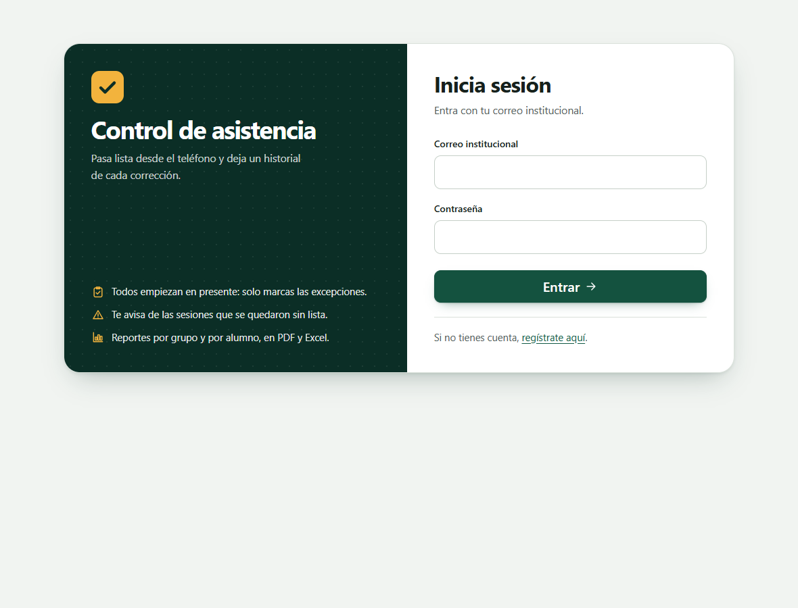

**Inicio del docente (A-01, A-02, A-03), a 1180 y a 375 px:**

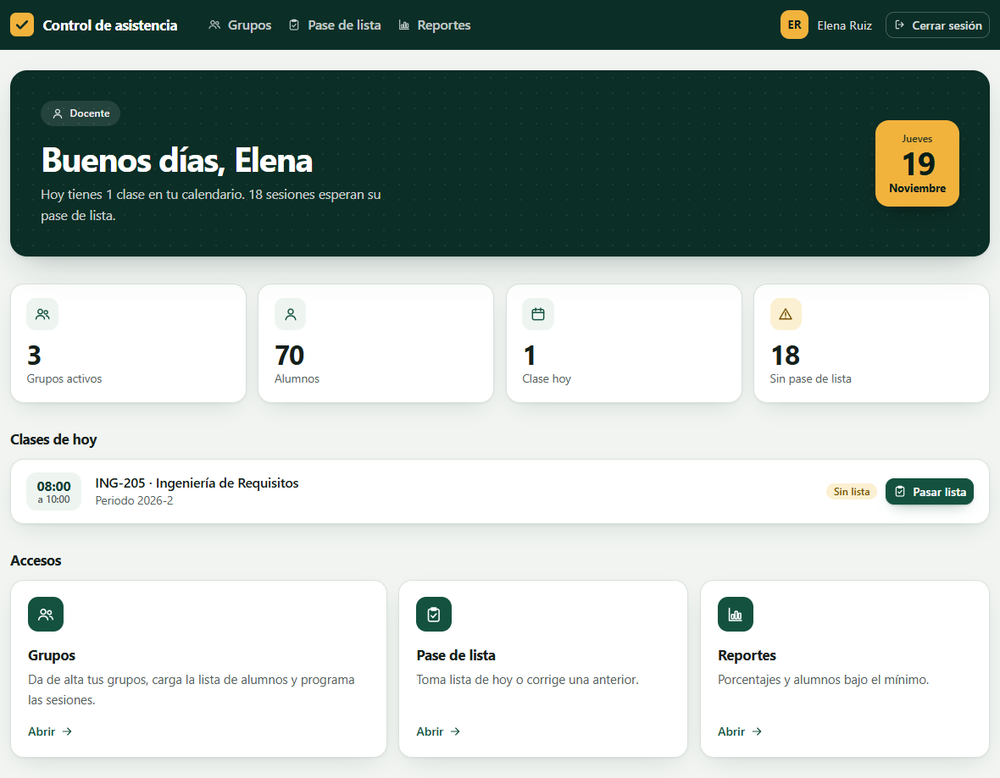

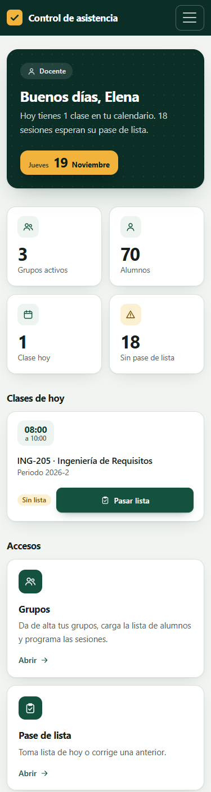

**Pase de lista en el teléfono (A-06, A-07):**

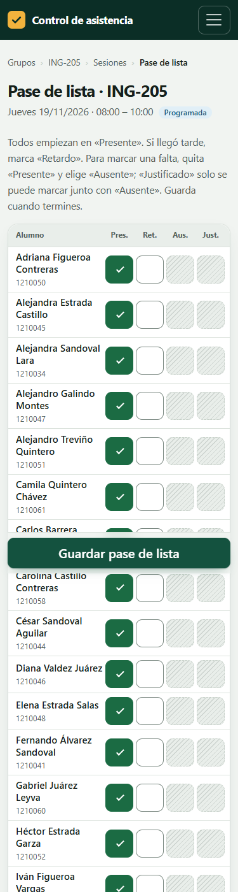

**Corrección e historial (A-06, A-11):**

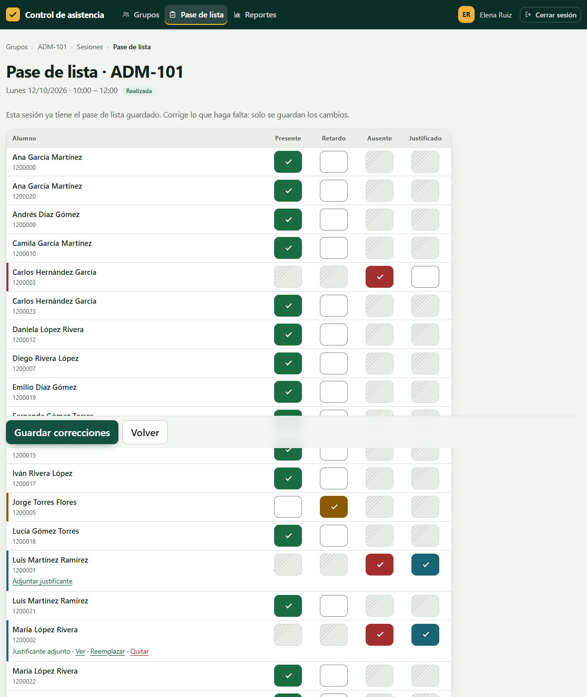

**Grupos, reporte y panel (A-02, A-04, A-08, A-09):**

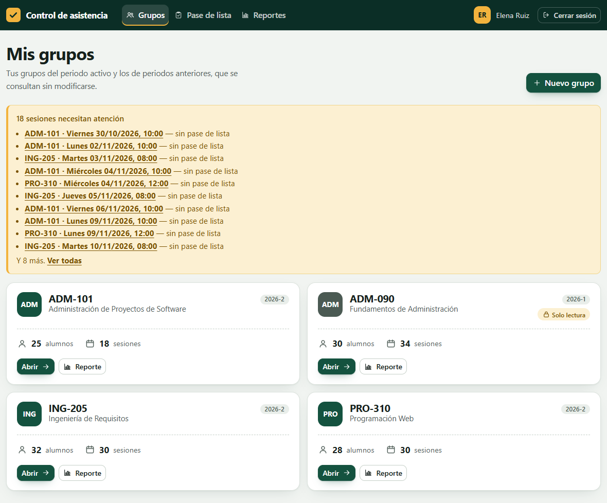

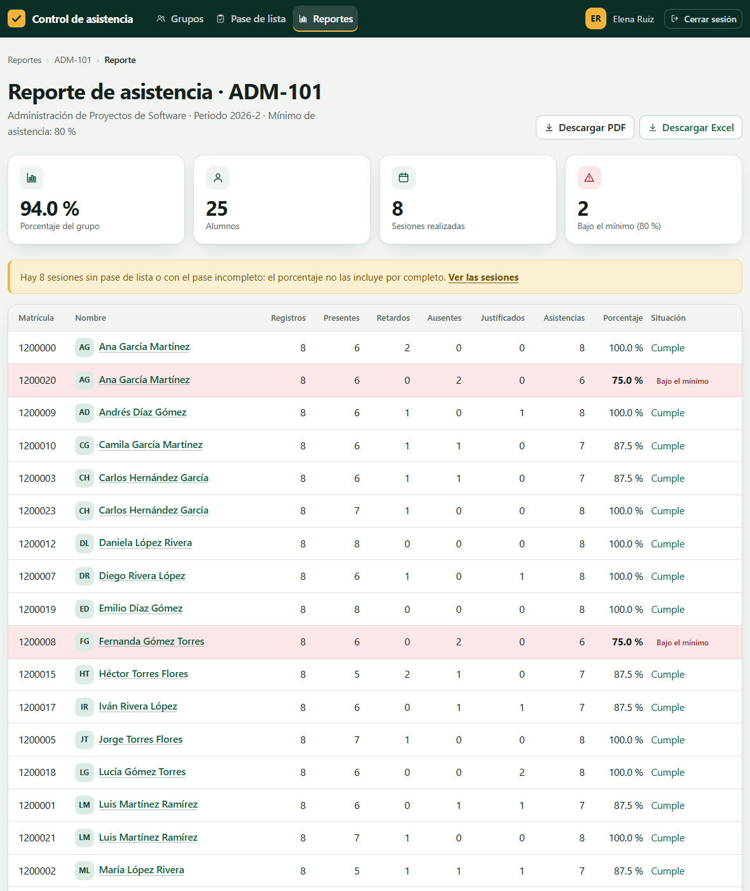

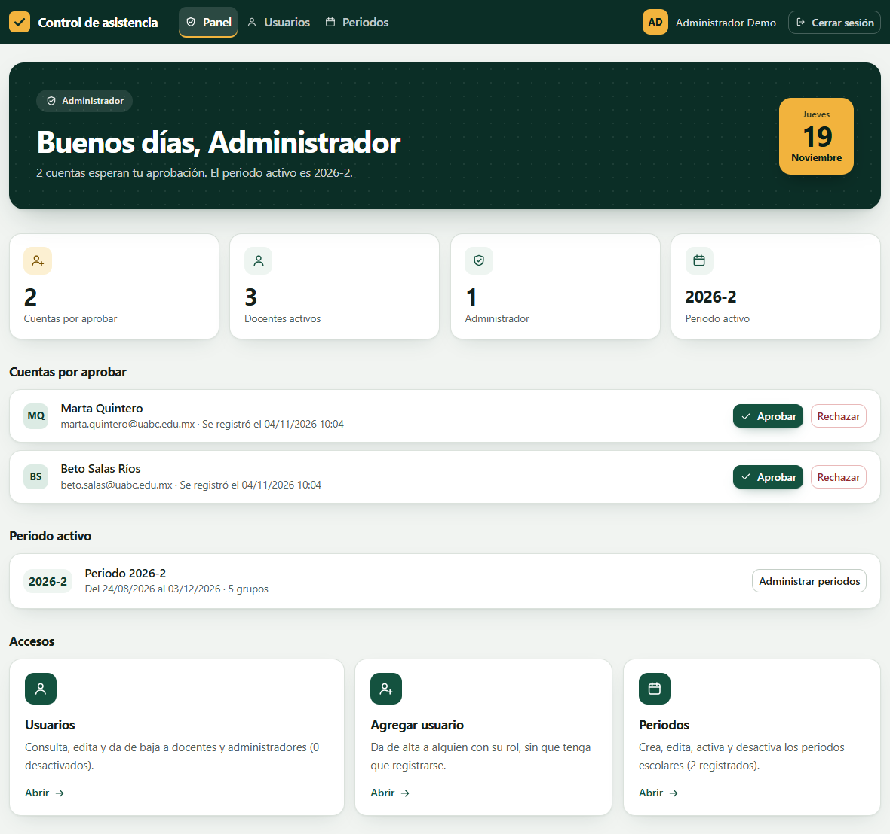

### 2.3 Qué pasa si no se hace

Nada se rompe. La entrega se presenta con una interfaz correcta pero intercambiable con cualquier panel de plantilla, que es justo lo que el líder pidió evitar.

## 3. Dirección visual propuesta: «la lista de asistencia»

La escena importante del sistema es el pase de lista en el salón; todo lo demás (grupos, sesiones, reportes) existe para preparar o explicar esa lista. La interfaz toma su vocabulario de **la hoja de asistencia en papel que sustituye**, sin imitar papel (nada de texturas, sombras de hoja ni letra manuscrita): solo sus reglas de composición.

| Rasgo del papel | Cómo se traduce | Pantallas |
|---|---|---|
| **Renglones** | Las listas son renglones con línea fina teñida de pino, no tarjetas apiladas. Las cifras van en un **renglón de cifras** con separadores verticales, como el pie de una hoja de asistencia, no en cuatro tarjetas | Pase de lista, grupos, tablas, cifras |
| **Línea de margen** | Una doble línea vertical en ámbar a la izquierda de las listas (el margen de la libreta) separa el **número de lista** del nombre. El número se dibuja con un contador de CSS: no entra al texto de la página | Pase de lista, tablas de alumnos |
| **Encabezado de formato** | Cada pantalla abre con un encabezado de formato: una línea de datos en monoespaciada (grupo, periodo, fecha, horario) sobre el título en serif y una doble regla debajo. El inicio deja el bloque oscuro y se vuelve **la hoja del día**: fecha grande, la clase de hoy con su botón como protagonista, y lo pendiente | Todas |
| **Tachado** | En el historial, el valor anterior se ve **tachado** y el nuevo escrito al lado (`<del>` e `<ins>`, que además son el marcado semántico de una corrección) | Corrección |
| **Sello** | Los estados (Realizada, Programada, Cancelada, Solo lectura, Sin registrar) dejan de ser píldoras y se ven como **sellos**: rectángulo de esquina corta, borde del color del texto, versalitas monoespaciadas | Todas |
| **Lápiz sobre lo que importa** | En el pase de lista, «Presente» marcado se vuelve tranquilo (palomita verde sobre fondo claro) y las **excepciones** (retardo, falta, justificado) conservan el relleno sólido: se ven de un vistazo, como las marcas que un docente hace en la lista. Un **conteo en vivo** en la barra de guardar dice cuántos presentes, retardos, faltas, justificados y sin registrar lleva antes de enviar | Pase de lista |

**Tipografía (sin descargar nada).** Tres papeles, todos con fuentes del sistema:

- **Títulos en serif** (`Sitka Heading`, Charter, Iowan Old Style, Cambria, Georgia, `serif`): la serif de un documento oficial, un acta o una lista impresa. Windows usa Sitka; iOS y macOS, Charter o Iowan; Android, Noto Serif.
- **Datos en monoespaciada** (`ui-monospace`, Cascadia Mono, SF Mono, Menlo, Consolas): matrícula, hora, fecha, clave del grupo, porcentaje y sellos, como el folio de un formato.
- **Texto en la sans del sistema**, como hoy.

Muestra de las fuentes candidatas en este equipo (Windows 11); se eligen Sitka Heading para títulos y Cascadia Mono para datos (Bahnschrift solo existe en Windows y Georgia no tiene cifras alineadas):

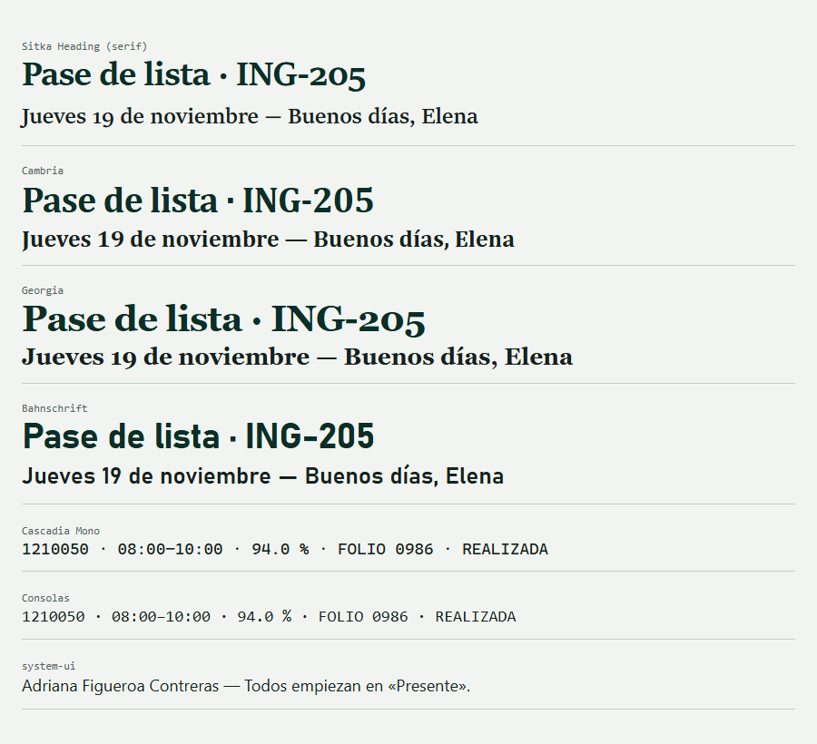

**Color.** No cambia ningún valor de la paleta confirmada el 9/11/2026 (pino `#0b2e26` y `#14523f`, ámbar `#f2b33d`, lienzo, superficie, tintas y los cuatro estados). Cambian las **proporciones**: el pino deja de ser un bloque de fondo y pasa a ser la tinta de títulos, reglas y renglones; el ámbar se usa en la línea de margen y como resaltador detrás de lo pendiente (texto oscuro sobre ámbar, 8.98:1). Se agregan solo tonos derivados (transparencias del pino para los renglones).

**Forma.** Esquinas más cortas y variadas: 4 px en sellos, 8 px en controles y casillas, 10 px en contenedores (antes, 16 px en todo). Sombras casi nulas: la jerarquía la dan las reglas, el tamaño y el peso, no la elevación.

**Movimiento.** Se conserva la entrada escalonada y se respeta `prefers-reduced-motion`. Al marcar una excepción la fila recibe su marca de color en el margen (ya existía) con una transición corta.

## 4. Alcance

**Dentro**, en este orden (de mayor a menor impacto): (1) base de estilos: tipografía, renglones, sellos, renglón de cifras, tablas y barra superior; (2) acceso y registro; (3) inicio del docente; (4) pase de lista, corrección e inicio del pase de lista; (5) grupos, detalle, sesiones y reportes; (6) panel del administrador; (7) tema del admin de Django; (8) páginas de error y formularios, en lo que herede de la base.

**Fuera**: modelo, migraciones, servicios, vistas, URL, exportaciones PDF y Excel, textos de la interfaz (salvo los anotados abajo), dependencias, fuentes web e ilustraciones. Las capturas de los manuales se regeneran en un paso aparte (sección 4 de la evaluación).

## 5. Elementos de configuración afectados

| ECS | Elemento | Línea base | Cambio |
|---|---|---|---|
| ECS-06 | `asistencia/static/asistencia/estilo.css`, `admin.css`, `pase_de_lista.js` | LB-C | Rediseño; el JavaScript agrega solo el conteo en vivo (presentación) |
| ECS-06 | Plantillas de `asistencia/templates/` (base, acceso, registro, inicio, pase de lista, grupos, sesiones, reportes, panel y admin) | LB-C | Marcado de presentación; las mismas variables de contexto |
| ECS-07 | `asistencia/tests/test_correccion.py` y las pruebas de estilo que hagan falta | LB-C | Ver «Pruebas» |
| ECS-01 | `CLAUDE.md`, sección 12 | LB-F | Decisiones de diseño vigentes |
| ECS-15 | `CHANGELOG.md` | LB-L | Entrada en `[Unreleased]` |
| ECS-16 | Este documento y el registro de decisiones de `gestion_configuracion.md` | LB-L | Archivo nuevo y fila nueva |
| ECS-17 | Capturas de `docs/img/manual_usuario/` y `docs/img/manual_administrador/` | LB-L | Quedan desactualizadas (paso aparte) |

## 6. Evaluación de impacto

| Aspecto | Impacto |
|---|---|
| Alcance y requisitos | Ningún RF ni RNF cambia. Se mantienen RNF-02 y RNF-10: casillas de al menos 44 px, encabezado de columnas fijo, sin desbordamiento desde 320 px, contraste de 4.5:1 en texto y 3:1 en el borde de las casillas, estado que no depende solo del color y `prefers-reduced-motion`. El conteo en vivo apoya al RNF-01 (revisar las excepciones antes de un único envío) y al RF-10 (cuántos quedan sin registrar) |
| Base de datos | Ninguno |
| Código | CSS, plantillas y un bloque de JavaScript de presentación. Las vistas reciben y entregan lo mismo |
| Pruebas | Siguen vigentes `test_estilo.py`, `test_casillas.py` y las que leen marcado (`btn-check`, `table-danger`, `text-bg-*`, `alert-link`, `class="acceso" href=`, el menú y los textos de pantalla). **Cambio previsto:** `test_correccion.py` busca el texto `Presente → Ausente`; con el tachado, el marcado pasa a `<del>Presente</del> → <ins>Ausente</ins>` y la prueba se actualiza a ese marcado. Se agregan pruebas de los tokens nuevos (contraste de los sellos y de la tinta de títulos) |
| Documentación | `CLAUDE.md`, `CHANGELOG.md`, `gestion_configuracion.md` y este documento. Los manuales no citan colores ni formas; **sus 31 capturas** (21 del docente y 10 del administrador) quedan desactualizadas y se proponen regenerar con el mismo guion de capturas en un paso aparte |
| Riesgo | Medio-bajo. (1) Una serif del sistema se ve distinta en cada plataforma: se eligió una pila con equivalentes en Windows, iOS, macOS y Android, y se revisa en Windows, que es donde corre la demostración. (2) El encabezado fijo del pase de lista depende del alto de la barra superior: se verifica a 320, 375, 768 y 1180 px. (3) Un cambio de texto podría romper una prueba o el manual: se buscan en las pruebas los textos que se toquen. (4) La pila de producción no se toca; el cambio se ve en el servidor de desarrollo |
| Esfuerzo | Un día de trabajo en pasos pequeños, más la suite completa (17 a 27 min) |

## 7. Alternativas consideradas

1. **Retocar «pino y ámbar» (más sombra, más color).** Se descarta: el problema no es la paleta sino la composición (tarjetas iguales, héroe, jerarquía plana).
2. **Fuente autoalojada con carácter** (por ejemplo una grotesca o una serif de texto). Se descarta en esta solicitud: requiere la aprobación de Victo y suma entre 40 y 120 KB por familia. La pila del sistema logra los tres papeles tipográficos sin descargar nada. Queda como decisión abierta.
3. **Ilustraciones** (una hoja de asistencia dibujada en el acceso). Se descartan por la misma regla; la identidad se logra con composición y tipografía.
4. **Migrar a otra pila (Tailwind, React).** Fuera de las restricciones del proyecto.
5. **Imitar papel** (textura, sombras de hoja, letra manuscrita). Se descarta: envejece mal, baja el contraste y se vuelve otra plantilla.

## 8. Decisión del comité de control de cambios

| Campo | Contenido |
|---|---|
| **Decisión** | Aprobada para implementarse en su rama (encargo del líder del 19/11/2026, que pidió el análisis y la implementación en pasos). La fusión a `main` queda pendiente de la revisión del pull request por Victo |
| **Fecha** | 2026-11-19 |
| **Responsable de la decisión** | Líder de proyecto (comité unipersonal, `gestion_configuracion.md` sección 1) |
| **Razón** | Riesgo medio-bajo, solo interfaz, reversible por rama y con pruebas que protegen contraste, casillas y marcado |
| **Condiciones** | No cambiar los tonos de marca sin una comparación visual y la respuesta de Victo. Sin fuentes, ilustraciones ni dependencias nuevas. Suite completa en verde antes de fusionar. Quedan abiertas para Victo: la paleta (se propone no tocarla), una fuente autoalojada (se propone no usarla) y el número de versión (se propuso `1.1.0`; **Victo eligió `1.1.0` el 20/11/2026**, ver sección 9) |

## 9. Implementación y verificación

| Campo | Contenido |
|---|---|
| **Rama** | `cambio/cr-003-rediseno-frontend` |
| **Pull request** | [Comparación con `main`](https://github.com/yahirslbv/asistence-control/compare/main...cambio/cr-003-rediseno-frontend?expand=1) (se abre desde ese enlace; `gh` no tiene sesión en este equipo) |
| **Versión en la que entra** | `1.1.0`, decidida por Victo el 20/11/2026 (un rediseño visible en todas las pantallas no es una corrección, así que no corresponde a PATCH). La etiqueta se pone al fusionar, no en esta rama |
| **Pruebas** | Ver la sección 10.3 |

## 10. Resultado

### 10.1 Qué se hizo, por commit

| Commit | Paso |
|---|---|
| `b848a57` | Esta solicitud, con las capturas «antes» |
| `3de971b` | Base de estilos: serif, monoespaciada, renglones, sellos y renglón de cifras; inicio del docente y panel con la hoja del día y el índice |
| `0a7581a` | Pase de lista: «Presente» tranquilo, margen del color del estado, número de lista, banda de encabezado, conteo en vivo, historial tachado; barra superior de alto fijo |
| `2a501b1` | Grupos, detalle, sesiones y reportes en renglones; sin fichas ni iniciales; filtros sin tarjeta |
| `4eb7bd9` | Formularios y confirmaciones con encabezado de formato y banda del membrete; página 500 |
| `46185be` | Capturas «después» |
| `85ad4f9` | Tema del admin de Django y su favicon |
| `cec94e0` | Pruebas de contraste de los tonos nuevos |
| `ca9039c` | Capturas del admin actualizadas (también en claro) y del pase de lista con excepciones |
| (siguiente) | Cierre: `CHANGELOG`, `CLAUDE.md`, registro de decisiones y esta sección |

Las capturas «después» están en `docs/cambios/img/cr-003/despues/`, con los mismos nombres que las de `antes/`, más las pantallas que no estaban (formularios, confirmaciones, página 500 y el admin en claro, con el sufijo `-claro`). En las 26 pantallas fotografiadas a 375 y a 1180 px (52 capturas) no hay desbordamiento horizontal (la 404 no se fotografió: con `DEBUG` encendido Django muestra su página técnica, no la del proyecto). El pase de lista se midió además desplazado a 320, 375, 768 y 1180 px: la barra superior mide 64 px y el encabezado de columnas queda pegado a 64 px en los cuatro anchos; las casillas miden 44×44 px en el teléfono y 56×44 desde 640 px; el nombre dispone de 86 px a 320, 141 px a 375, 324 px a 768 y 476 px a 1180.

**Inicio del docente, después:**

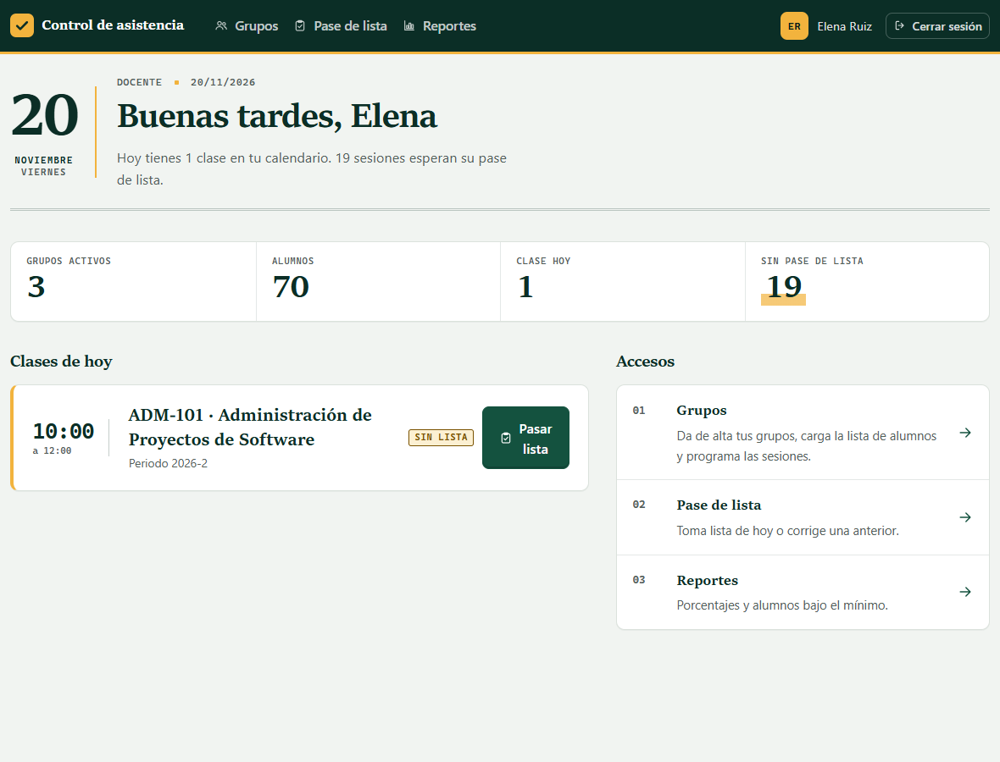

**Pase de lista en el teléfono, después** (con un retardo, una falta justificada y un alumno sin registrar):

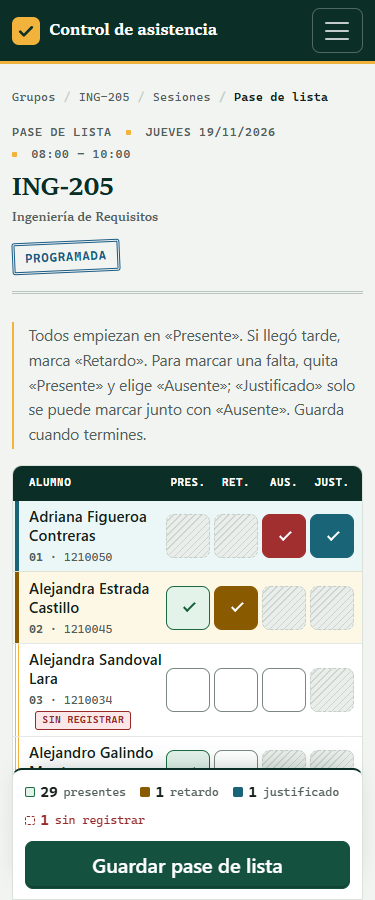

**Corrección, después:**

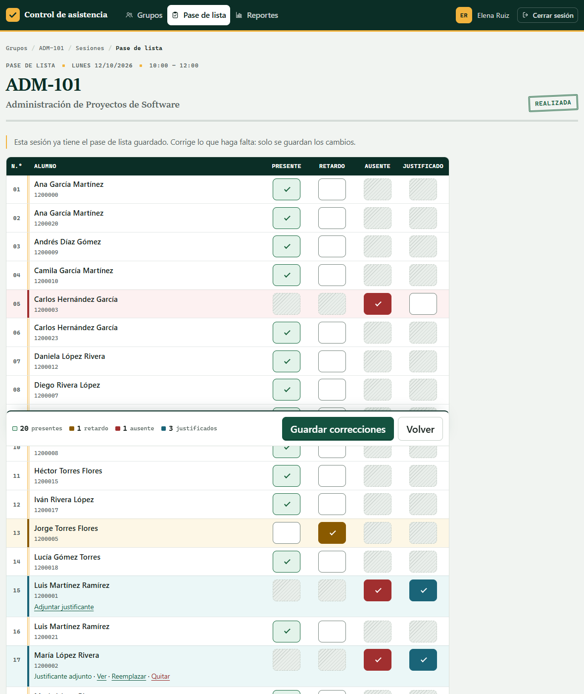

**Grupos y panel, después:**

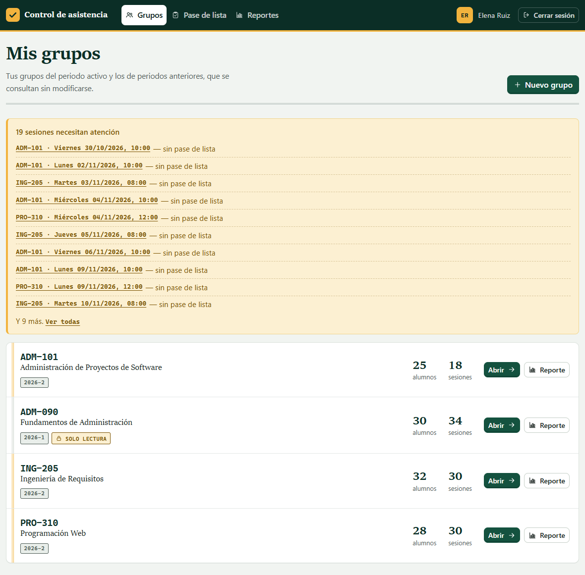

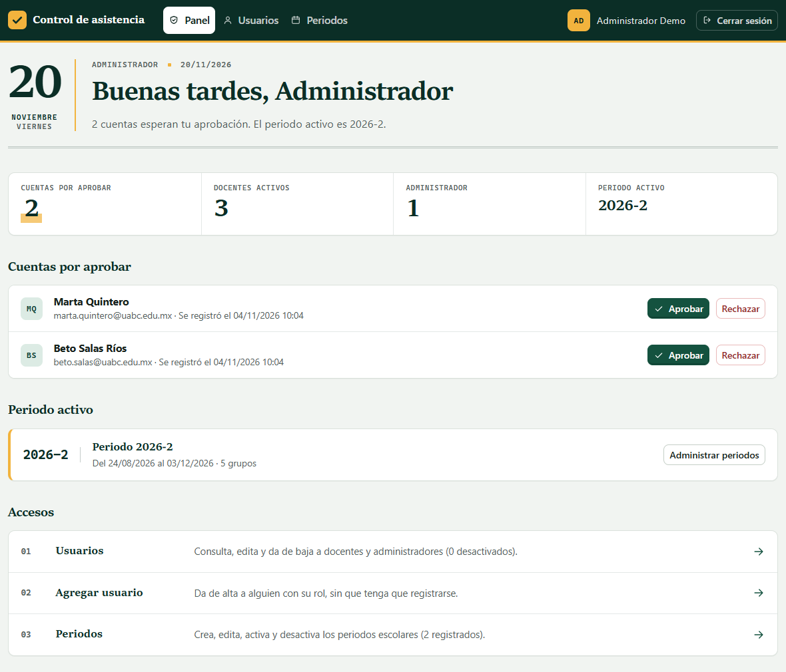

### 10.2 Contenedores por pantalla

Una marca de plantilla de IA es meter todo en tarjetas. Se contaron con el mismo criterio en las dos versiones (la de `main` servida desde una copia temporal y la de esta rama, con la misma base y a 1180 px): un contenedor es un elemento dentro de `<main>` de al menos 160×40 px con fondo distinto del de la página y borde en al menos tres lados o sombra; no cuentan botones, sellos, casillas ni campos.

| Pantalla | Antes | Después | Los que quedan y por qué |
|---|---|---|---|
| Acceso | 1 | 1 | La hoja del formulario (la marca ya no es un bloque oscuro) |
| Registro | 1 | 1 | Ídem |
| Inicio del docente | 9 | 3 | Renglón de cifras, la clase de hoy (la acción del día) y el índice de accesos |
| Grupos | 5 | 2 | Aviso de sesiones pendientes (RF-10) y la hoja de renglones de los grupos |
| Detalle del grupo | 6 | 3 | Aviso de pendientes, renglón de cifras y la hoja de alumnos |
| Sesiones | 3 | 2 | Una hoja por mes (cada mes es su propia tabla, con columnas alineadas); el filtro dejó su tarjeta |
| Inicio del pase de lista | 19 | 2 | La sesión de hoy y una sola hoja con los pendientes (antes, una tarjeta por sesión) |
| Pase de lista | 1 | 2 | La lista y su pie fijo (conteo y «Guardar»), que ahora se separa de la lista al desplazarse |
| Corrección | 2 | 3 | Lista, pie fijo e historial |
| Reportes | 2 | 1 | La tabla; el filtro dejó su tarjeta |
| Reporte de grupo | 8 | 5 | Renglón de cifras, aviso y tabla; las otras dos son las celdas de las filas bajo el mínimo (RF-14), que el criterio detecta igual en las dos versiones |
| Reporte de alumno | 6 | 3 | Renglón de cifras, aviso y tabla |
| Grupo en solo lectura | 6 | 3 | Aviso de periodo inactivo, renglón de cifras y hoja |
| Grupo nuevo, agregar alumno, generar sesiones, justificante | 1 cada una | 1 cada una | La hoja del formulario |
| Cargar CSV | 3 | 3 | Formulario, formato esperado y ejemplo |
| Eliminar grupo, rechazar cuenta | 1 cada una | 1 cada una | El aviso de lo que se borra o se desactiva |
| Panel del administrador | 11 | 4 | Renglón de cifras, hoja de cuentas por aprobar, periodo activo e índice de accesos |
| **Total (21 pantallas de la aplicación)** | **89** | **44** | |
| Admin de Django (5 pantallas) | 8 | 8 | Los módulos de Django: el tema cambia su aspecto, no su estructura |

### 10.3 Pruebas

- Por bloques, en la base `analisis_front` (y `analisis_front_estilo` para no chocar con la suite): estilo, inicio, panel, acceso y registro (127 pruebas); pase de lista, casillas, corrección, periodo congelado, sesión futura y justificantes (168); casillas, pendientes y estilo (87); grupos, reportes, sesiones, pendientes, flujos e inscripciones (225); formularios, errores, 500 y panel (129); estilo y admin (87); estilo con las pruebas nuevas (19). Todas correctas.
- **Prueba cambiada:** `test_correccion.py` buscaba el texto `Presente → Ausente`; ahora busca `<del>Presente</del> → <ins>Ausente</ins>`.
- **Pruebas nuevas:** el pie del pase de lista trae el conteo oculto y vacío hasta que lo llena el script (`test_casillas.py`); contraste de la tinta de títulos, la etiqueta de formato, la banda del encabezado y los sellos sin relleno (`test_estilo.py`; el más bajo, 6.57:1).
- **Conteo en vivo, en el navegador:** marcando casillas sin guardar, el conteo pasa de «32 presentes» a «31 presentes · 1 sin registrar», «31 presentes · 1 ausente», «31 presentes · 1 justificado», «30 presentes · 1 retardo · 1 justificado» y «29 presentes · 1 retardo · 1 justificado · 1 sin registrar», que es la misma correspondencia del servidor.
- **Suite completa** (MySQL 8.0, base `analisis_front`, sobre `85ad4f9`): 684 pruebas, todas correctas, en 798.8 s; código de salida 0. Las tres pruebas de contraste agregadas después en `cec94e0` se corrieron aparte con todo `test_estilo.py` (19 pruebas, correctas).

### 10.4 Pendiente

- **Capturas de los manuales.** Las 31 quedan desactualizadas y se regeneran en un paso aparte con el mismo guion de capturas: `docs/img/manual_usuario/` (01-acceso a 21-cuenta-pendiente, las 21) y `docs/img/manual_administrador/` (01-panel a 10-periodo-edicion, las 10). Los textos de los manuales no citan colores ni formas; el único texto de pantalla que cambió de marcado es el del historial, y el manual no lo cita.
- **Decisiones de Victo (20/11/2026), todas tomadas:** la versión es `1.1.0`; **la serif de los títulos se queda** (Sitka Heading y equivalentes del sistema); **el conteo en vivo del pase de lista se queda**.
