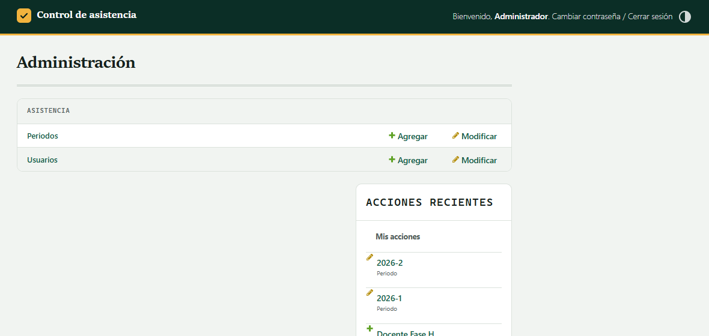
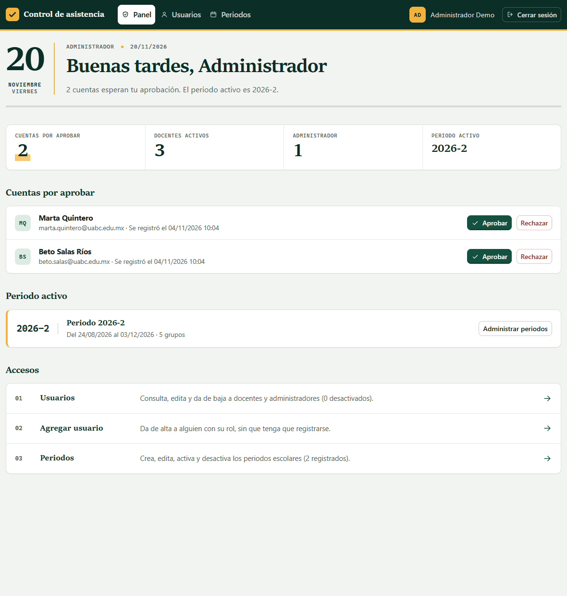
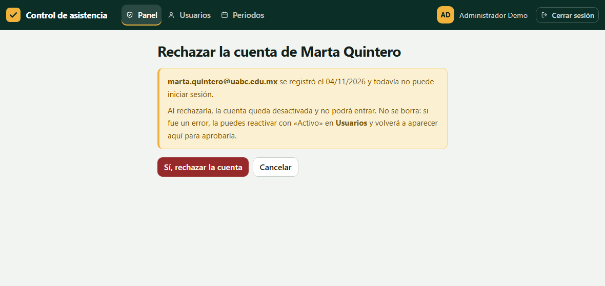
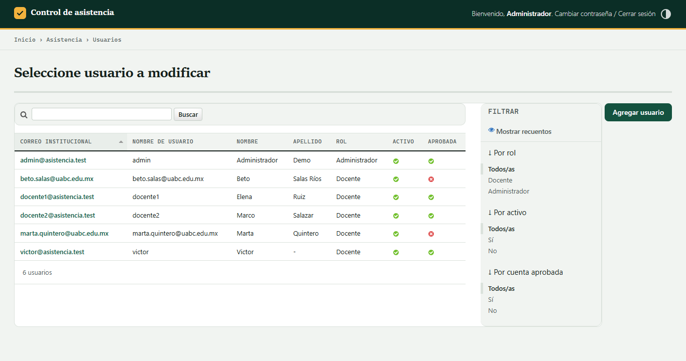
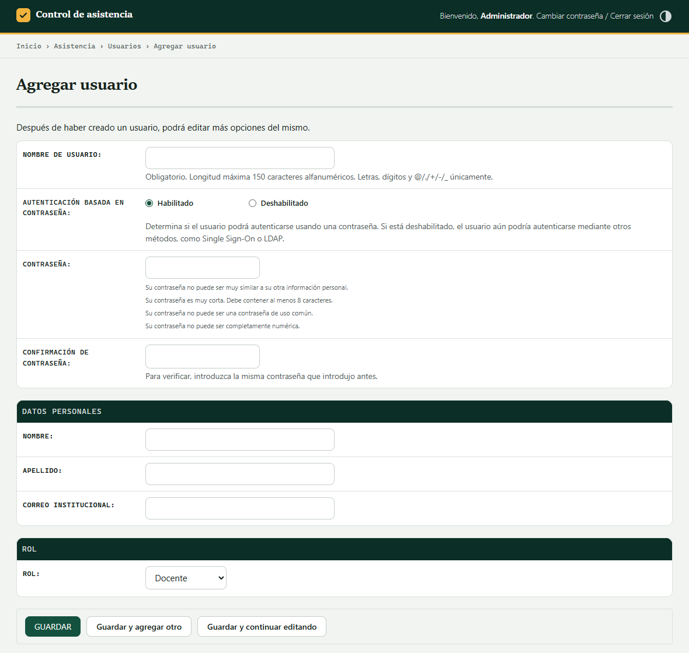
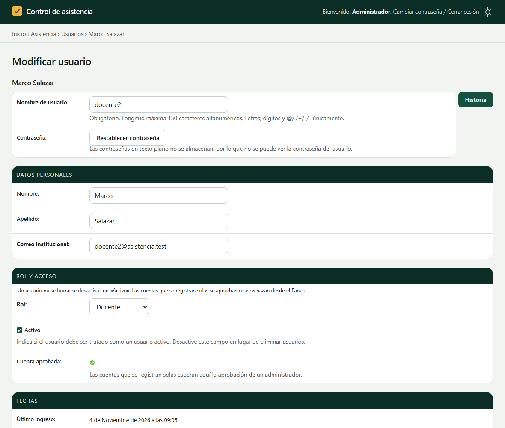
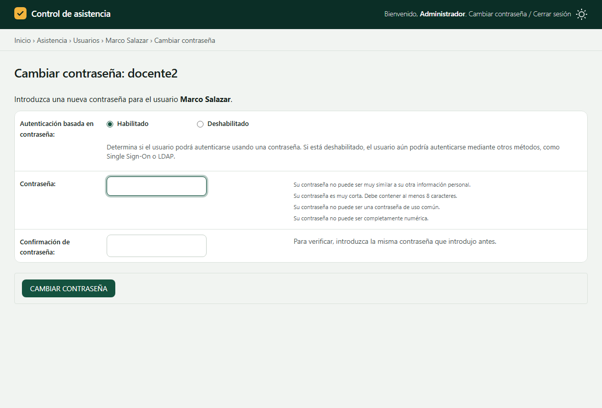
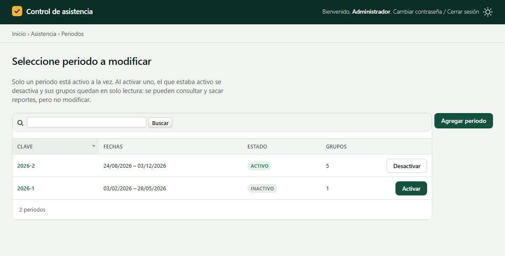
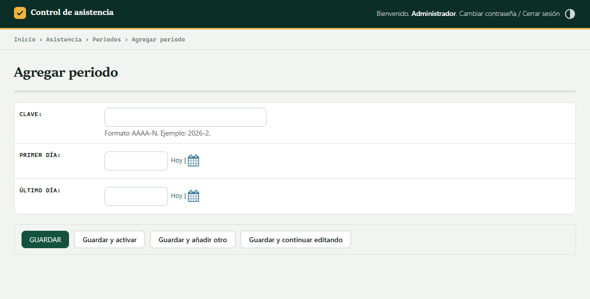
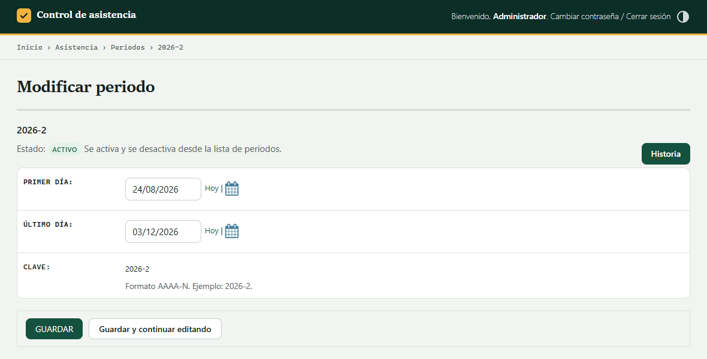

# Manual del administrador

Sistema de Control de Asistencia · UABC, FCITEC · Administración de Proyectos de Software.

| | |
|---|---|
| **Para quién es** | Quien administra el sistema: aprueba cuentas, da de alta usuarios y maneja los periodos escolares |
| **Versión del sistema** | 1.1.0 |
| **Última revisión** | 21/11/2026 |
| **Manual del docente** | [manual_usuario.md](manual_usuario.md) |

Este manual explica cómo aprobar o rechazar las cuentas de los docentes, dar de alta y dar de baja usuarios, cambiar una contraseña y abrir o cerrar un periodo escolar. Las pantallas de ejemplo usan datos de demostración, no datos reales.

**Contenido**

1. [Qué hace el administrador](#1-qué-hace-el-administrador)
2. [Entrar y moverte por el sistema](#2-entrar-y-moverte-por-el-sistema)
3. [El Panel](#3-el-panel)
4. [Aprobar o rechazar cuentas](#4-aprobar-o-rechazar-cuentas)
5. [Usuarios](#5-usuarios)
6. [Periodos escolares](#6-periodos-escolares)
7. [Tareas frecuentes](#7-tareas-frecuentes)
8. [Lo que el administrador no puede hacer](#8-lo-que-el-administrador-no-puede-hacer)
9. [Si algo no sale como esperabas](#9-si-algo-no-sale-como-esperabas)

---

## 1. Qué hace el administrador

El administrador cuida tres cosas:

- **Las cuentas.** Los docentes se registran solos, pero su cuenta no sirve hasta que tú la apruebas. También puedes dar de alta a alguien directamente, cambiarle la contraseña o desactivar su cuenta.
- **Los periodos escolares.** Tú decides cuál está activo. Los docentes solo pueden crear grupos en el periodo activo, y los grupos de un periodo que ya no está activo quedan en solo lectura.
- **Los roles.** Cada cuenta es de **docente** o de **administrador**.

El administrador **no ve los grupos, los alumnos ni las listas de asistencia de los docentes**. Esa información es de cada docente. Si entras a esas pantallas, el sistema responde «No tienes permiso para ver esta página».

## 2. Entrar y moverte por el sistema

Entra con tu **correo** y tu contraseña en la pantalla de acceso. Al iniciar sesión llegas al **Panel**.

El sistema tiene dos zonas que se ven parecidas pero se comportan distinto:

| Zona | Qué contiene | Cómo se llega |
|---|---|---|
| **Panel** | Cuentas por aprobar, cifras y el periodo activo | Al iniciar sesión, o con **Panel** en la barra superior |
| **Administración** | Las listas y formularios de **Usuarios** y de **Periodos** | Con **Usuarios** o **Periodos** en la barra superior del Panel, o con los accesos del Panel |

El inicio de la Administración muestra solo dos opciones, **Periodos** y **Usuarios**, cada una con **Agregar** y **Modificar** (para consultar y editar los que ya existen):

Dentro de la Administración, la barra superior muestra «Control de asistencia» (lleva a ese inicio), tu nombre, **Cambiar contraseña** (la tuya) y **Cerrar sesión**. A la derecha hay un interruptor para ver la Administración con tema claro, oscuro o automático.

> **Para volver al Panel desde la Administración:** esas pantallas no traen un botón «Panel». Usa el botón **Atrás** del navegador, o borra de la barra de direcciones todo lo que sigue al nombre del sitio y pulsa Enter: la página principal te lleva a tu Panel.

Para salir, pulsa **Cerrar sesión**.

## 3. El Panel

El Panel es tu pantalla de inicio. De arriba abajo muestra:

- **Un saludo** con tu nombre («Buenos días», «Buenas tardes» o «Buenas noches») y una frase que resume lo pendiente: cuántas cuentas esperan tu aprobación y cuál es el periodo activo. Si no hay nada pendiente dice «No hay cuentas esperando aprobación.», y si no hay periodo activo, «No hay un periodo activo.»
- **Cuatro cifras:** *Cuentas por aprobar*, *Docentes activos*, *Administrador* (o *Administradores*) y *Periodo activo*.
- **Cuentas por aprobar:** una fila por cada persona que se registró y espera respuesta, con sus botones **Aprobar** y **Rechazar** (sección 4).
- **Periodo activo:** su clave, sus fechas y cuántos grupos tiene, con el botón **Administrar periodos**. Si no hay periodo activo, el Panel avisa «No hay un periodo activo: los docentes no pueden crear grupos nuevos.»
- **Accesos:** *Usuarios* (consultar, editar y dar de baja), *Agregar usuario* (dar de alta a alguien sin que tenga que registrarse) y *Periodos*. Cada uno se abre al pulsarlo.

El Panel solo cuenta los grupos del periodo activo; no muestra cuáles son ni de quién.

## 4. Aprobar o rechazar cuentas

Cuando un docente se registra desde la pantalla de acceso, su cuenta queda **pendiente**: todavía no puede iniciar sesión. La persona aparece en **Cuentas por aprobar**, con su correo y la fecha y hora en que se registró.

El registro tiene tres condiciones que fija el sistema y que tú no necesitas revisar:

- el correo debe ser de un dominio permitido (por defecto `@uabc.edu.mx`);
- la cuenta siempre nace con rol **docente**;
- no se confirma el correo por mensaje: el sistema no envía correos. **La verificación de que la persona es quien dice ser la haces tú** al aprobar.

### 4.1. Aprobar

Pulsa **Aprobar** en la fila de la persona. El sistema responde «Cuenta de *nombre* aprobada: ya puede iniciar sesión.» y la fila desaparece de la lista. Aprobar no pide confirmación.

Avisa a la persona, porque el sistema no le manda ningún mensaje. Las cuentas se atienden de la más antigua a la más reciente.

Aprobar y rechazar quedan anotados: en la **Historia** de la cuenta (sección 5.3) se ve qué administrador lo hizo y cuándo.

### 4.2. Rechazar

Pulsa **Rechazar**. El sistema te pide confirmar:

Pulsa **Sí, rechazar la cuenta** para confirmar o **Cancelar** para volver al Panel. El sistema responde «Cuenta de *nombre* rechazada: quedó desactivada.»

Rechazar **no borra** la cuenta: la deja desactivada, y su correo sigue ocupado (esa persona no puede volver a registrarse con él). Si fue un error, abre la cuenta en **Usuarios**, marca **Activo** y guarda: la cuenta vuelve a aparecer en el Panel para que la apruebes.

Si otra persona administradora ya atendió la cuenta, el Panel te avisa («Esa cuenta ya no está esperando aprobación.») en lugar de fallar.

## 5. Usuarios

### 5.1. La lista de usuarios

Pulsa **Usuarios** en la barra superior (o el acceso **Usuarios** del Panel).

La lista muestra, por cada persona: **Correo institucional**, **Nombre de usuario**, **Nombre**, **Apellido**, **Rol**, **Activo** y **Aprobada**. Una marca verde significa «sí» y una roja, «no». Una cuenta que espera aprobación tiene **Activo** en verde y **Aprobada** en rojo; una cuenta rechazada tiene las dos en rojo.

- **Buscar:** escribe parte del correo, del nombre de usuario, del nombre o del apellido y pulsa **Buscar**.
- **Filtrar:** el panel de la derecha filtra **Por rol**, **Por activo** y **Por cuenta aprobada**. **Mostrar recuentos** agrega cuántas cuentas hay en cada opción.
- **Ordenar:** pulsa el título de una columna.

Para abrir una cuenta, pulsa su correo.

### 5.2. Dar de alta a un usuario

Úsalo para crear a un administrador o a un docente sin que pase por el registro. La cuenta que das de alta **nace aprobada**: puede entrar de inmediato.

Pulsa **Agregar usuario** (en la lista o en el Panel).

| Campo | Qué escribir |
|---|---|
| **Nombre de usuario** | Un nombre único. Hasta 150 caracteres: letras, dígitos y `@` `.` `+` `-` `_`. Una buena costumbre es usar el correo |
| **Autenticación basada en contraseña** | Déjalo en **Habilitado**. «Deshabilitado» crea una cuenta que no puede entrar con contraseña |
| **Contraseña** y **Confirmación de contraseña** | La contraseña inicial, dos veces. Debe tener al menos 8 caracteres, no ser muy parecida a los datos de la persona, no ser de uso común y no ser solo números |
| **Nombre** y **Apellido** | Los de la persona (obligatorios) |
| **Correo institucional** | Su correo. Es con el que inicia sesión y no se puede repetir |
| **Rol** | **Docente** o **Administrador** |

Pulsa **Guardar**. Con **Guardar y agregar otro** el formulario queda listo para el siguiente, y con **Guardar y continuar editando** te quedas en la ficha de la persona.

El rol decide lo que la persona puede hacer: un **administrador** entra a su Panel y a la Administración; un **docente** entra a sus grupos y nada más. El sistema ajusta esos accesos solo al guardar, así que no hay permisos sueltos que configurar.

Entrega la contraseña inicial a la persona por un medio seguro y pídele que no la comparta.

### 5.3. Editar una cuenta

Abre la cuenta desde la lista.

Puedes cambiar el **nombre de usuario**, el **nombre**, el **apellido**, el **correo institucional**, el **rol** y **Activo**. **Cuenta aprobada** solo se ve: no se edita, porque cambia al aprobar o rechazar desde el Panel. Más abajo se ven la fecha del último ingreso y la fecha de creación, y el enlace **Historia** (arriba a la derecha) muestra los cambios hechos a la ficha. Pulsa **Guardar** al terminar.

### 5.4. Cambiar la contraseña de otra persona

Si un docente olvida su contraseña, el sistema no le manda un enlace para recuperarla: se la cambias tú.

1. Abre su cuenta.
2. En **Contraseña**, pulsa **Restablecer contraseña**.
3. Escribe la nueva contraseña dos veces.
4. Pulsa **Cambiar contraseña**.

Entrégale la contraseña nueva por un medio seguro. Tu propia contraseña la cambias con **Cambiar contraseña** en la barra superior de la Administración.

> No pulses **Deshabilitar la autenticación basada en contraseña** salvo que quieras que esa cuenta deje de poder entrar con contraseña: al deshabilitarla, la contraseña actual se pierde.

### 5.5. Dar de baja a un usuario

**Un usuario no se borra: se desactiva.** Así se conservan sus grupos y su historial.

1. Abre la cuenta.
2. Quita la marca de **Activo**.
3. Pulsa **Guardar**.

La persona ya no puede iniciar sesión, pero sus grupos y registros se conservan. Para reactivarla, vuelve a marcar **Activo**.

Hay dos protecciones para que el sistema nunca se quede sin quien lo administre:

- «No puedes desactivarte a ti mismo.»
- «No se puede desactivar ni quitar el rol al último administrador activo: el sistema se quedaría sin quien gestione usuarios.» Antes de desactivar a un administrador, o de cambiarle el rol a docente, asegúrate de que haya otro administrador activo.

No puedes modificar la cuenta de un superusuario (una cuenta técnica creada al instalar el sistema).

## 6. Periodos escolares

Un **periodo** es un ciclo escolar con una clave con el formato `AAAA-N` (por ejemplo, `2026-2`) y un primer y un último día. **Solo un periodo está activo a la vez.**

Esto es lo que cambia según el estado del periodo:

| | Periodo **activo** | Periodo **inactivo** |
|---|---|---|
| Crear grupos nuevos | Sí, y solo en este periodo | No |
| Modificar sus grupos (alumnos, sesiones, pase de lista, correcciones, justificantes) | Sí | **No: quedan en solo lectura** |
| Consultar sus grupos, reportes, Excel y PDF | Sí | Sí |

Los docentes ven los grupos de un periodo inactivo con la etiqueta «Solo lectura».

### 6.1. La lista de periodos

Pulsa **Periodos** en la barra superior.

Cada fila muestra la **Clave**, las **Fechas**, el **Estado** («Activo» o «Inactivo»), cuántos **Grupos** tiene y un botón: **Desactivar** si está activo o **Activar** si no lo está.

### 6.2. Crear un periodo

Pulsa **Agregar periodo**.

| Campo | Qué escribir |
|---|---|
| **Clave** | Con el formato `AAAA-N` (por ejemplo, `2027-1`). No se puede repetir |
| **Primer día** | Cuándo empieza el periodo |
| **Último día** | Cuándo termina. Debe ser posterior al primer día |

Tienes cuatro botones:

- **Guardar:** crea el periodo **inactivo**.
- **Guardar y activar:** lo crea y lo **activa** en un solo paso (desactiva el que estaba activo).
- **Guardar y añadir otro** y **Guardar y continuar editando**, como en las demás pantallas.

Si algo está mal, el formulario lo dice: «Usa el formato AAAA-N, por ejemplo 2026-2.», «Ya existe un periodo con esa clave.» o «El último día debe ser posterior al primer día.»

### 6.3. Activar un periodo

En la lista, pulsa **Activar** en la fila del periodo. El navegador te pregunta: «Activar *2027-1* desactivará el periodo que esté activo y sus grupos quedarán en solo lectura. ¿Continuar?» Acepta para continuar.

El sistema responde, por ejemplo: «Periodo 2027-1 activado. El periodo 2026-2, que estaba activo, se desactivó: sus 5 grupos quedan en solo lectura.»

**Piensa antes de activar:** los docentes dejarán de poder modificar los grupos del periodo anterior. Hazlo cuando ya cerraron sus listas.

### 6.4. Desactivar un periodo

En la lista, pulsa **Desactivar** en la fila del periodo activo. El navegador pregunta: «Desactivar *2026-2* dejará sus 5 grupos en solo lectura. ¿Continuar?»

El sistema responde «Periodo 2026-2 desactivado: sus 5 grupos quedan en solo lectura.» Si con eso ya no queda ningún periodo activo, agrega: «Ya no hay un periodo activo: nadie podrá crear grupos hasta que actives uno.»

Desactivar y volver a activar el mismo periodo es posible y no pierde nada: los grupos vuelven a poder modificarse.

### 6.5. Editar un periodo

Pulsa la clave del periodo en la lista.

Puedes cambiar el **Primer día** y el **Último día**. La **Clave** solo se puede cambiar mientras el periodo no tiene grupos: en cuanto tiene alguno, se ve pero no se edita, porque los grupos guardan esa clave. El estado no se cambia aquí sino desde la lista (en un periodo inactivo, además, está el botón **Guardar y activar**).

Los periodos **no se borran**, para que sus grupos sigan teniendo un periodo al que pertenecen.

## 7. Tareas frecuentes

### Abrir un periodo nuevo

1. Espera a que los docentes terminen de pasar lista en el periodo actual.
2. Ve a **Periodos** y pulsa **Agregar periodo**.
3. Escribe la clave y las fechas, y pulsa **Guardar y activar**.
4. Avisa a los docentes: ya pueden crear sus grupos del periodo nuevo, y los del anterior quedaron en solo lectura.

### Un docente nuevo necesita entrar

- **Si se registra solo:** dile que use «regístrate aquí» en la pantalla de acceso con su correo `@uabc.edu.mx`, y después apruébalo desde el Panel (sección 4).
- **Si prefieres darlo de alta tú** (por ejemplo, porque su correo no es de un dominio permitido): sección 5.2.

### Un docente olvidó su contraseña

Cámbiasela desde su ficha (sección 5.4) y entrégale la nueva.

### Un docente ya no va a usar el sistema

Desactiva su cuenta (sección 5.5). No se borra nada.

### Alguien necesita ser administrador

Abre su cuenta, cambia el **Rol** a **Administrador** y guarda. Para quitarle el rol, cámbialo a **Docente**, siempre que quede al menos otro administrador activo.

## 8. Lo que el administrador no puede hacer

Por diseño, el administrador **no puede**:

- ver ni modificar los grupos, alumnos, sesiones, listas ni justificantes de los docentes (cada docente ve solo lo suyo);
- borrar usuarios ni periodos: se desactivan;
- editar las marcas «Cuenta aprobada», «superusuario» o los permisos sueltos de una cuenta: el rol los decide;
- desactivarse a sí mismo ni dejar al sistema sin administradores.

Además, el sistema **no envía correos**: no hay mensajes de bienvenida, de aprobación ni de recuperación de contraseña. Tú avisas a las personas.

## 9. Si algo no sale como esperabas

| Situación | Qué hacer |
|---|---|
| Un docente no puede crear un grupo | Probablemente no hay un periodo activo. Actívalo en **Periodos** (sección 6.3) |
| Un docente ve «Tu cuenta está pendiente de aprobación» | Búscalo en **Cuentas por aprobar** en el Panel y apruébalo (sección 4.1) |
| Un docente dice «Correo o contraseña incorrectos» | Revisa que su cuenta esté **Activa** y **Aprobada** en la lista de usuarios; si no recuerda su contraseña, cámbiasela (sección 5.4) |
| Alguien rechazado por error quiere entrar | Marca **Activo** en su ficha: volverá al Panel para que lo apruebes (sección 4.2) |
| Una persona no puede registrarse y dice «Solo se admiten correos de @uabc.edu.mx» | Su correo no es de un dominio permitido. Dala de alta tú (sección 5.2) |
| Una persona dice «Ya existe una cuenta con ese correo» | Búscala en **Usuarios**. Si está desactivada o rechazada, reactívala con **Activo** |
| «No puedes desactivarte a ti mismo» | Pide a otro administrador que lo haga |
| «No se puede desactivar ni quitar el rol al último administrador activo» | Antes da de alta o promueve a otro administrador (sección 7) |
| «No tienes permiso para ver esta página» | Estás en una pantalla de docentes (grupos, pase de lista o reportes), que el administrador no ve. Vuelve al Panel |
| «Algo salió mal» | El servidor tuvo un problema. Intenta de nuevo en unos minutos y, si continúa, avisa a quien mantiene el servidor |
| No encuentro cómo volver al Panel | Sección 2: botón **Atrás** del navegador o la página principal del sitio |
