# Manual de usuario (docente)

Sistema de Control de Asistencia · UABC, FCITEC · Administración de Proyectos de Software.

| | |
|---|---|
| **Para quién es** | Docentes que pasan lista con el sistema |
| **Versión del sistema** | 0.9.0 |
| **Última revisión** | 16/11/2026 |
| **Manual del administrador** | [manual_administrador.md](manual_administrador.md) |

Este manual explica, paso a paso, cómo usar el sistema para dar de alta tus grupos, cargar a tus alumnos, programar las clases, pasar lista, corregir un registro, adjuntar un justificante y sacar los reportes. Las pantallas de ejemplo usan datos de demostración, no datos reales.

**Contenido**

1. [Qué es el sistema](#1-qué-es-el-sistema)
2. [Antes de empezar](#2-antes-de-empezar)
3. [Crear tu cuenta y entrar](#3-crear-tu-cuenta-y-entrar)
4. [La pantalla de inicio](#4-la-pantalla-de-inicio)
5. [Tus grupos](#5-tus-grupos)
6. [Los alumnos del grupo](#6-los-alumnos-del-grupo)
7. [Las sesiones (las clases)](#7-las-sesiones-las-clases)
8. [Pasar lista](#8-pasar-lista)
9. [Corregir un registro y adjuntar un justificante](#9-corregir-un-registro-y-adjuntar-un-justificante)
10. [Reportes](#10-reportes)
11. [Grupos de periodos anteriores (solo lectura)](#11-grupos-de-periodos-anteriores-solo-lectura)
12. [Si algo no sale como esperabas](#12-si-algo-no-sale-como-esperabas)
13. [Glosario](#13-glosario)

---

## 1. Qué es el sistema

El sistema sustituye la lista de asistencia en papel. Con él puedes:

- pasar lista desde el teléfono o la computadora, marcando solo las excepciones;
- tener un único registro por alumno y por clase, sin duplicados;
- enterarte de las clases a las que se les quedó sin pasar lista;
- corregir un registro con un historial que guarda quién lo cambió, cuándo y qué valor tenía antes;
- adjuntar el justificante de una falta;
- ver el porcentaje de asistencia de cada alumno y de cada grupo, y descargarlo en PDF y Excel.

Cada docente ve y modifica **solo sus propios grupos**. Nadie más puede ver tus listas.

## 2. Antes de empezar

Necesitas:

- un **correo institucional** (`@uabc.edu.mx`);
- un navegador actualizado, en la computadora o en el teléfono (el sistema se adapta al tamaño de la pantalla);
- que el administrador del sistema haya **activado un periodo escolar**. Sin un periodo activo no puedes crear grupos (ver la sección 5).

## 3. Crear tu cuenta y entrar

### 3.1. Crear tu cuenta

En la pantalla de acceso, pulsa el enlace **regístrate aquí**, junto a «Si no tienes cuenta».

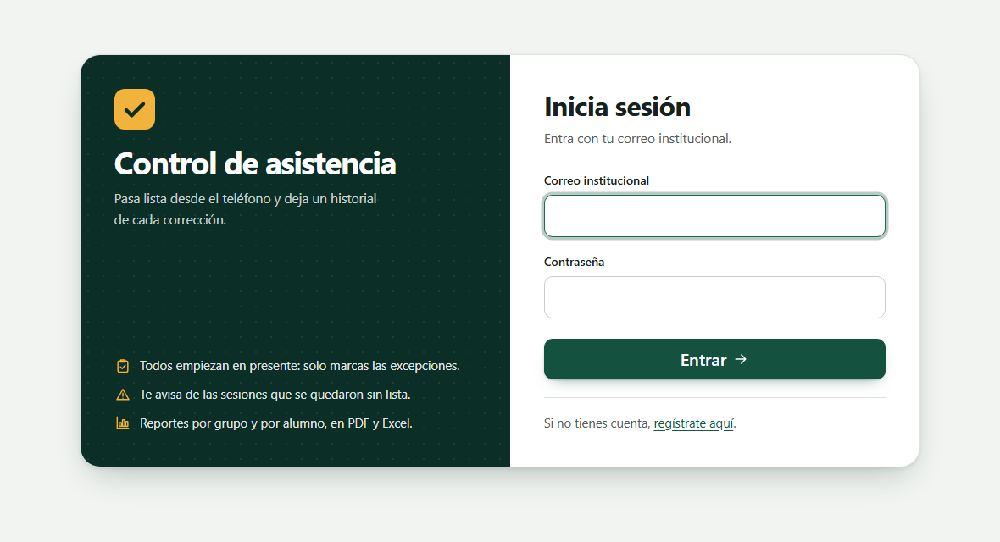

Llena el formulario:

| Campo | Qué escribir |
|---|---|
| Nombre y Apellido | Los tuyos |
| Correo institucional | Tu correo `@uabc.edu.mx`. Con otro dominio el sistema responde «Solo se admiten correos de @uabc.edu.mx.» |
| Contraseña | La que quieras, con estas reglas: no muy parecida a tu información personal, de al menos 8 caracteres, que no sea de uso común y que no sea solo números |
| Repite la contraseña | La misma contraseña |

Pulsa **Crear cuenta**.

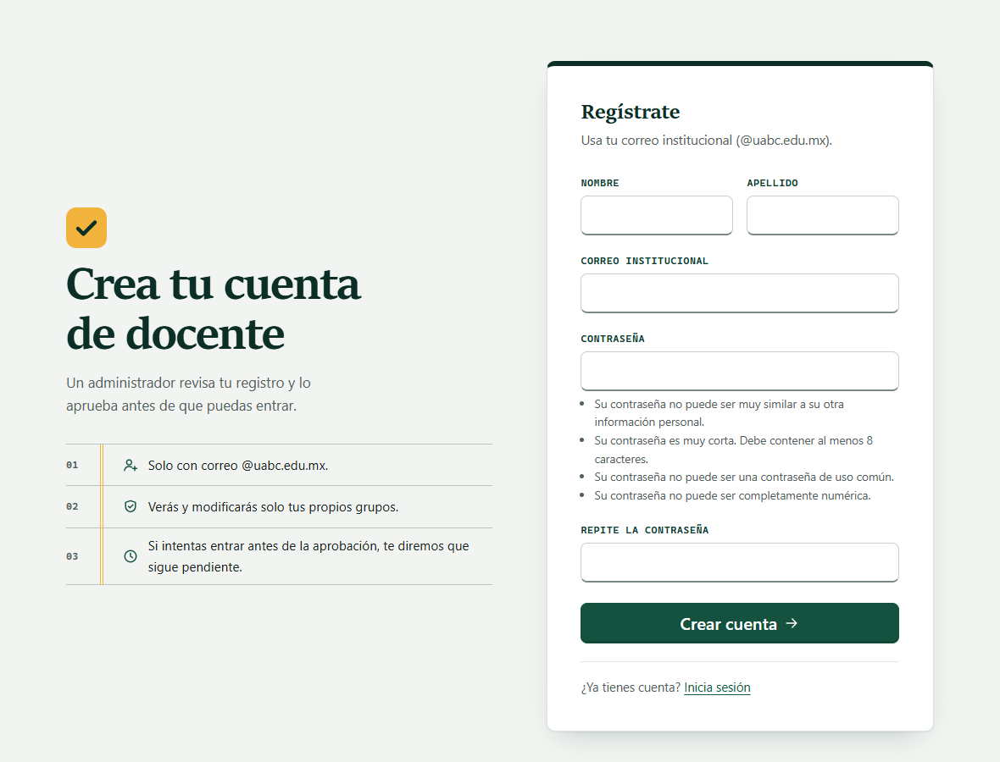

Tu cuenta **no queda activa de inmediato**: un administrador debe aprobarla. Mientras tanto, si intentas entrar con tu correo y tu contraseña, el sistema te dice «Tu cuenta está pendiente de aprobación. Podrás entrar cuando un administrador la apruebe.»

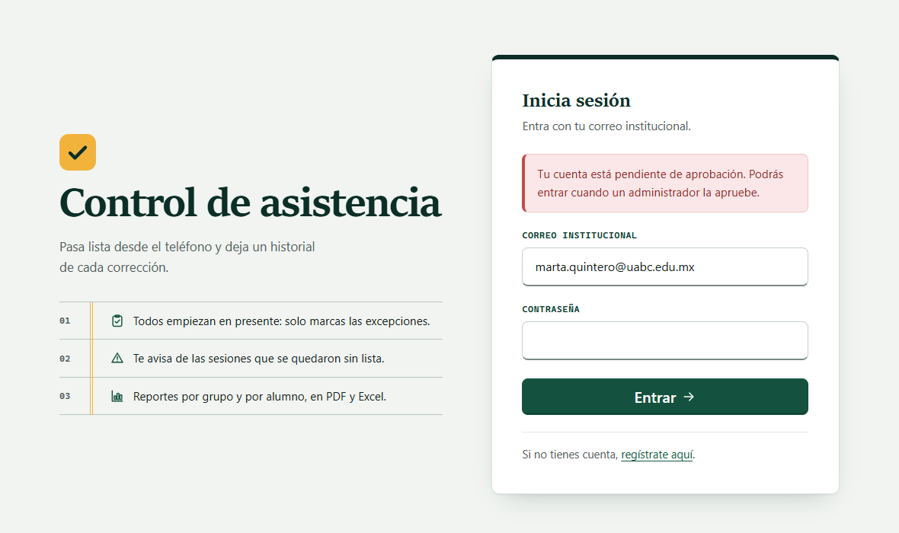

Cuando el administrador apruebe tu cuenta, entra con tu correo y tu contraseña. Tu cuenta siempre es de **docente**.

Si el correo ya tiene una cuenta, el sistema responde «Ya existe una cuenta con ese correo.»

### 3.2. Iniciar sesión

1. Escribe tu **correo institucional** y tu **contraseña**.
2. Pulsa **Entrar**.

Si alguno de los dos datos no es correcto, verás «Correo o contraseña incorrectos.»

El sistema no recupera contraseñas por sí solo (no envía correos). Si la olvidas, avisa al administrador: puede cambiártela.

### 3.3. Cerrar sesión

Pulsa **Cerrar sesión**, arriba a la derecha. En el teléfono, el menú está detrás del botón de las tres rayas.

## 4. La pantalla de inicio

Al entrar llegas al inicio. Arriba ves un saludo, la fecha y cuántas clases tienes hoy y cuántas esperan su pase de lista.

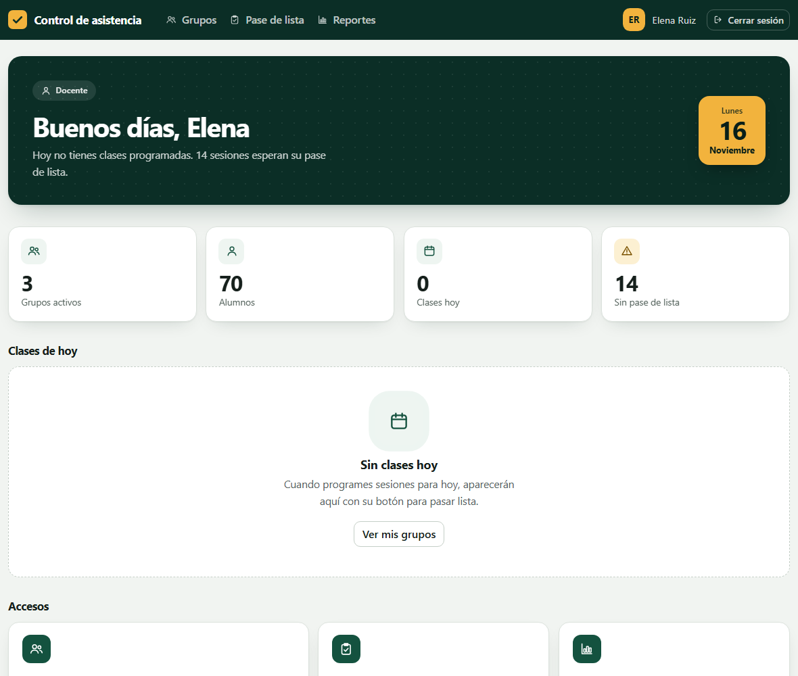

- **Los cuatro recuadros** resumen tus grupos activos, tus alumnos, las clases de hoy y las sesiones sin pase de lista.
- **Clases de hoy** muestra cada clase con su botón para pasar lista. Si no tienes clases, lo dice.
- **Accesos** lleva a Grupos, Pase de lista y Reportes.

El menú de arriba está siempre disponible: **Grupos**, **Pase de lista** y **Reportes**.

## 5. Tus grupos

Pulsa **Grupos** en el menú. En «Mis grupos» ves tus grupos del periodo activo y los de periodos anteriores.

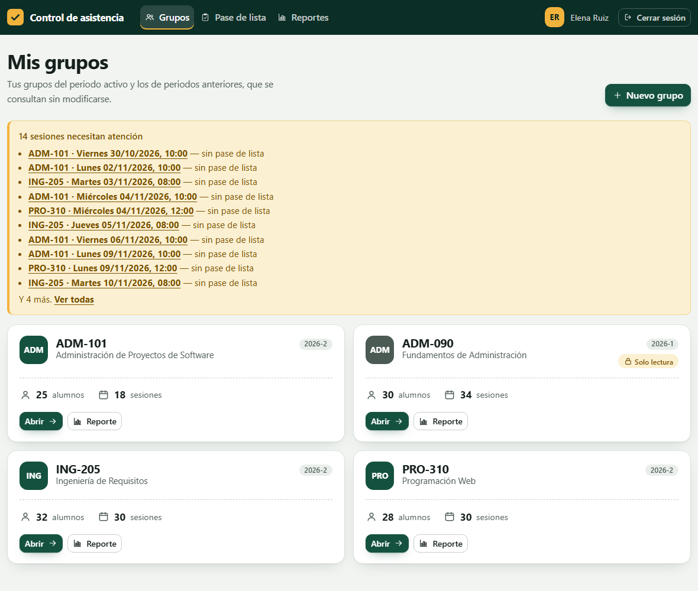

Cada grupo muestra su clave, su materia, su periodo, cuántos alumnos y cuántas sesiones tiene, y dos botones: **Abrir** y **Reporte**. Los grupos de un periodo que ya no está activo llevan la etiqueta «Solo lectura» (ver la sección 11).

El recuadro amarillo, cuando aparece, te avisa de las sesiones que necesitan atención (ver la sección 8.5).

### 5.1. Crear un grupo

1. Pulsa **Nuevo grupo**.
2. Escribe la **Clave** (única por periodo; por ejemplo, ADM-101) y la **Materia**.
3. El **Periodo** es el periodo activo; solo se pueden crear grupos en él.
4. Pulsa **Guardar**. Verás «Grupo ADM-101 creado.»

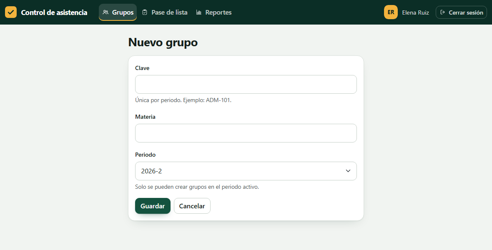

Si ya existe un grupo con esa clave en el periodo, el sistema responde «Ya existe un grupo con esa clave en ese periodo.» Si no hay ningún periodo activo, el formulario te lo avisa y no te deja guardar: pide al administrador que active uno.

### 5.2. Ver un grupo

Pulsa **Abrir** en un grupo. Arriba están los botones **Sesiones**, **Reporte**, **Editar** y **Eliminar grupo**. Debajo, el número de alumnos inscritos, el periodo, las sesiones por atender y el estado del grupo, y la lista de alumnos.

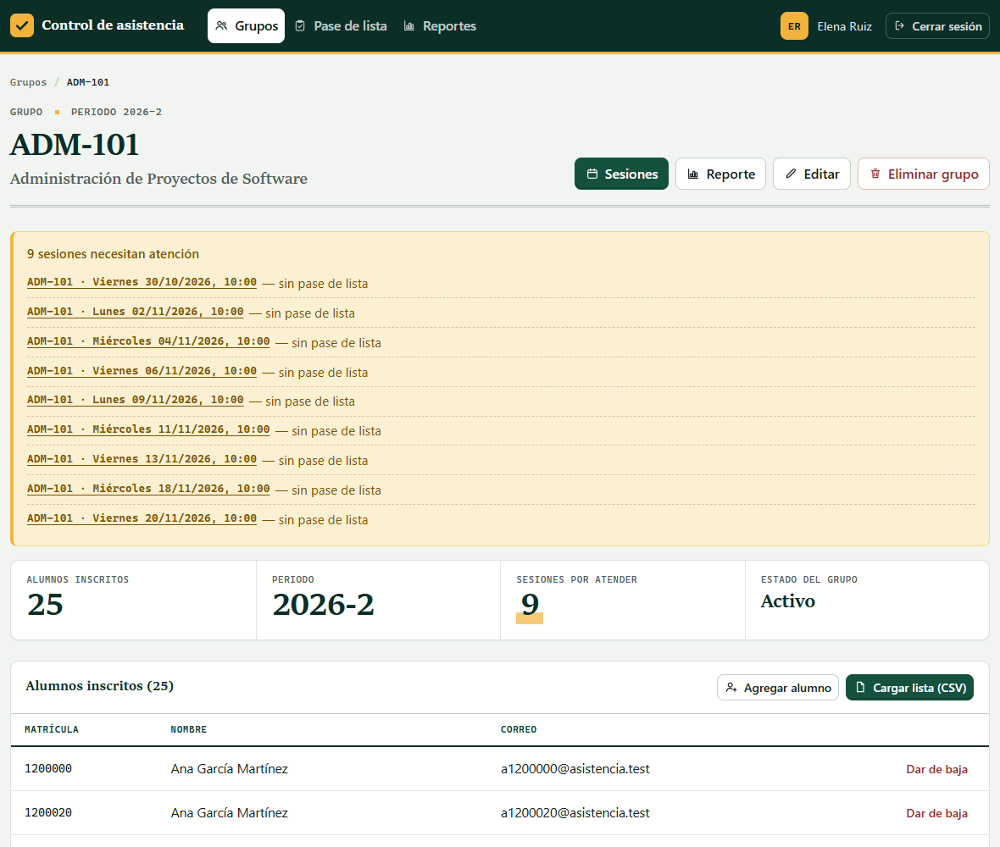

### 5.3. Editar un grupo

Pulsa **Editar**, cambia la clave o la materia y pulsa **Guardar**. Verás «Cambios guardados.» El periodo del grupo se conserva.

### 5.4. Eliminar un grupo

Pulsa **Eliminar grupo**. El sistema no lo borra de inmediato: te muestra todo lo que se perdería con él, por ejemplo:

- las sesiones;
- las inscripciones de alumnos;
- los registros de asistencia;
- las correcciones de la bitácora;
- los justificantes adjuntos (los archivos también se borran del servidor).

**Esta acción no se puede deshacer.** Si de verdad quieres continuar, pulsa **Sí, eliminar el grupo y su historial**; si no, **Cancelar**. Antes de eliminar un grupo, descarga su reporte (sección 10).

## 6. Los alumnos del grupo

### 6.1. Cargar la lista desde un archivo CSV

Dentro del grupo, pulsa **Cargar lista (CSV)**.

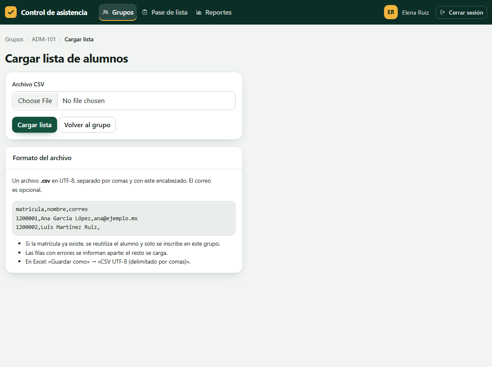

El archivo debe cumplir lo siguiente:

- es un archivo `.csv` en **UTF-8**, separado por comas;
- la primera fila es el encabezado `matricula,nombre,correo`; el correo es opcional;
- pesa **hasta 1 MB** y tiene **hasta 500 filas** (si tienes más alumnos, divide la lista en varios archivos).

Ejemplo:

```
matricula,nombre,correo
1200001,Ana García López,ana@ejemplo.mx
1200002,Luis Martínez Ruiz,
```

Si trabajas en Excel, usa «Guardar como» y elige «CSV UTF-8 (delimitado por comas)».

Elige el archivo y pulsa **Cargar lista**. El sistema te muestra un resumen:

| Dato | Qué significa |
|---|---|
| Filas leídas | Cuántas filas con datos tenía el archivo |
| Alumnos inscritos en el grupo | Cuántos quedaron inscritos |
| De ellos, nuevos en el padrón | Cuántos alumnos no existían antes en el sistema |
| Ya estaban inscritos | Cuántos ya estaban en este grupo |
| Filas con error | Cuántas filas no se pudieron cargar, con el motivo de cada una |

Las filas con errores se informan aparte y **el resto se carga**. Los motivos más comunes son: «Falta la matrícula.», «Falta el nombre.», «El correo no es válido.» y «Matrícula repetida en el archivo; se ignoró.» Corrige esas filas y vuelve a cargar el archivo: repetir la carga no duplica a nadie.

Si la matrícula de una fila ya existe en el sistema, se reutiliza el alumno y solo se inscribe en este grupo.

Si todo el archivo se rechaza, el sistema te explica por qué: por ejemplo, «El archivo no está en UTF-8.», «El archivo está vacío.» o «El archivo tiene más de 500 filas. Divide la lista en varios archivos.»

### 6.2. Agregar un alumno

1. Dentro del grupo, pulsa **Agregar alumno**.
2. Escribe la **Matrícula** y el **Nombre completo**; el **Correo** es opcional.
3. Pulsa **Inscribir**.

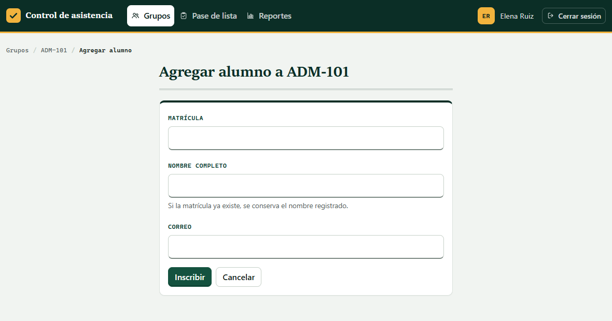

Si la matrícula ya existe en el sistema, se conserva el nombre registrado. Verás un mensaje como «Ana García López se agregó a ADM-101.», o «Ana García López ya forma parte de este grupo.» si ya estaba.

### 6.3. Dar de baja a un alumno

En la lista del grupo, pulsa **Dar de baja** junto al alumno y confirma con **Sí, dar de baja**. El alumno se quita del grupo y ya no aparece en sus listas. **Sus registros de asistencia en ese grupo se conservan**, y puede inscribirse de nuevo cuando haga falta. Mientras esté dado de baja, no cuenta en los reportes del grupo.

## 7. Las sesiones (las clases)

Una **sesión** es una clase de tu grupo en una fecha y a una hora. Para pasar lista, primero tiene que existir la sesión.

Dentro del grupo, pulsa **Sesiones**. Verás el calendario por mes, con la fecha, el horario y el estado de cada sesión: **Programada**, **Realizada** o **Cancelada**. Con **Desde**, **Hasta** y **Filtrar** puedes ver solo un rango de fechas.

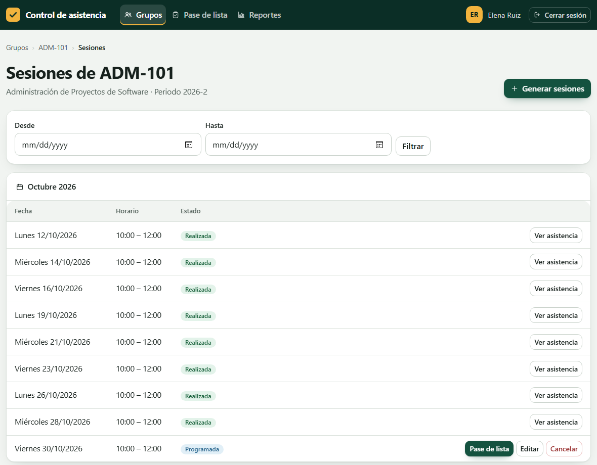

### 7.1. Generar las sesiones de un periodo

1. Pulsa **Generar sesiones**.
2. Marca los **Días de clase** (por ejemplo, lunes, miércoles y viernes).
3. Escribe la **Hora de inicio** y la **Hora de fin**.
4. Escribe el **Primer día del periodo** y el **Último día del periodo**.
5. Pulsa **Generar sesiones**.

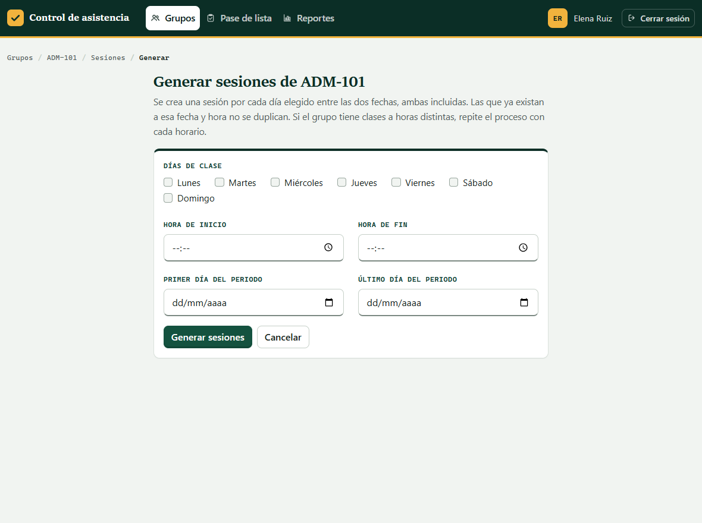

Se crea una sesión por cada día elegido entre las dos fechas, ambas incluidas. Las que ya existan a esa fecha y hora no se duplican. Si tu grupo tiene clases a horas distintas, repite el proceso con cada horario.

El sistema te avisa con «Se programaron N sesiones.» y, si algunas ya existían, con «N ya estaban programadas a esa fecha y hora de inicio, y no se tocaron.»

Los errores que puede mostrar el formulario son: «Elige al menos un día de la semana.», «La hora de fin debe ser posterior a la de inicio.», «El último día no puede ser anterior al primero.», «El periodo no puede pasar de 366 días.» y «Ninguna fecha del periodo cae en los días elegidos.»

### 7.2. Editar una sesión

En una sesión **Programada**, pulsa **Editar**, cambia la fecha o las horas y pulsa **Guardar**. Verás «Sesión actualizada.» Si el grupo ya tiene otra sesión en esa fecha y hora de inicio, el sistema te lo dice.

### 7.3. Cancelar una sesión

En una sesión **Programada**, pulsa **Cancelar** y confirma con **Sí, cancelar la sesión**. La sesión se conserva en el calendario como cancelada y ya no admite pase de lista. Verás «Sesión cancelada.»

## 8. Pasar lista

Esta es la pantalla que más vas a usar. Está pensada para el teléfono, dentro del salón.

### 8.1. Abrir la lista de una clase

Hay tres caminos:

- Menú **Pase de lista**: arriba están las sesiones de hoy y abajo las de días anteriores que todavía esperan su lista. Pulsa **Pase de lista** en la clase que quieras.
- Desde **Sesiones** de un grupo, con el botón **Pase de lista** de la sesión.
- Desde el recuadro amarillo de sesiones pendientes (sección 8.5).

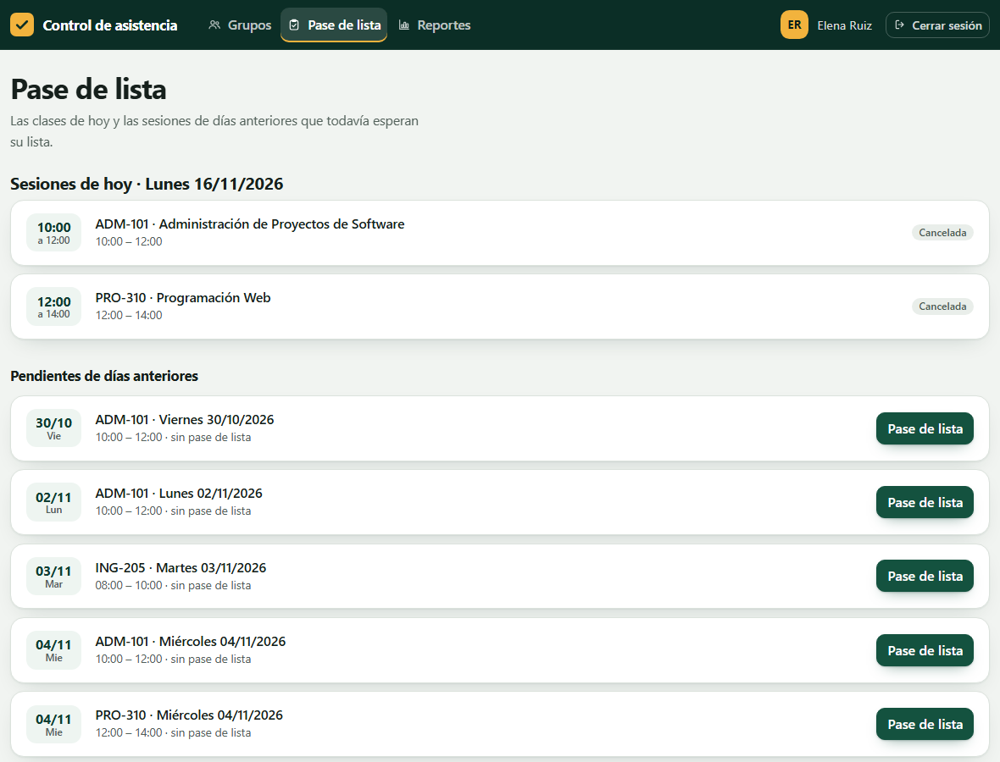

Solo se puede pasar lista a una sesión de **hoy o de un día anterior**. Si abres una sesión futura, el sistema te dice que el pase de lista se habilita ese día. Una sesión cancelada no admite registros.

### 8.2. Marcar la asistencia

Al abrir la lista, **todos los alumnos empiezan en «Presente»**. Tú solo marcas las excepciones. Cada alumno tiene una fila: su nombre y matrícula a la izquierda y cuatro casillas a la derecha, una por estado. Los nombres de las columnas están arriba y se quedan visibles mientras recorres la lista.

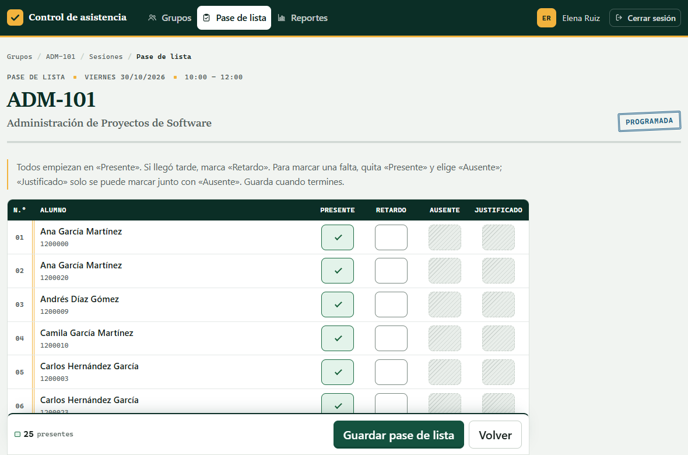

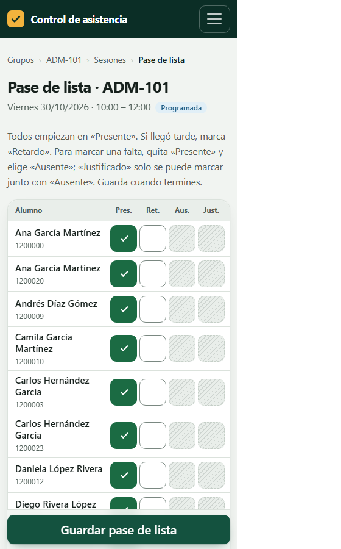

En el teléfono, los encabezados se abrevian: Pres., Ret., Aus. y Just.

Qué hacer para cada caso:

| El alumno... | Qué haces | Qué se guarda |
|---|---|---|
| Llegó a tiempo | Nada: ya está en «Presente» | presente |
| Llegó tarde | Marca «Retardo» | retardo |
| Faltó | Quita «Presente» y marca «Ausente» | ausente |
| Faltó y tiene justificación | Quita «Presente», marca «Ausente» y luego «Justificado» | justificado |

Cada registro guarda **un solo estado**. «Presente», «retardo» y «justificado» cuentan como asistencia; «ausente» no.

Para que no te equivoques, algunas casillas se **bloquean** según lo que marques. Las casillas bloqueadas se ven **rayadas** y con el borde punteado, y no responden al toque:

- Con «Presente» o «Retardo» marcados, «Ausente» y «Justificado» quedan bloqueados.
- Con «Ausente» marcado, «Presente» y «Retardo» quedan bloqueados.
- «Justificado» solo se puede marcar junto con «Ausente».

Por eso, para marcar una falta tienes que quitar primero «Presente»: al hacerlo se habilitan las demás casillas.

En el ejemplo, cada fila muestra uno de los casos: el primer alumno está presente, el segundo ausente, el tercero con retardo y el cuarto ausente con justificación. Observa las casillas rayadas y la franja de color a la izquierda de cada fila que no está presente:

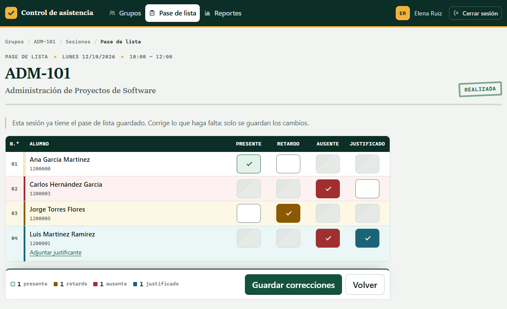

Si quitas todas las casillas de un alumno, la fila muestra **Sin registrar** y ese alumno queda sin registro hasta que lo corrijas.

### 8.3. Guardar el pase de lista

Pulsa **Guardar pase de lista**, el botón fijo en la parte baja de la pantalla. Verás «Pase de lista guardado: N registros.» y la sesión pasa a **Realizada**.

Cosas que debes saber:

- El guardado se hace de una sola vez. Si por error se envía dos veces, el sistema **no duplica** nada: avisa que la lista ya estaba guardada y la abre para corregirla.
- Si dejaste a algún alumno sin casillas, el sistema avisa cuántos quedaron sin registrar.
- Si una combinación de casillas no es válida (por ejemplo, «Presente» y «Ausente» a la vez), el sistema **no guarda nada** y te dice qué alumnos revisar: «Revisa las casillas de: ... No se guardó nada.»

### 8.4. Cuánto trabajo es

Como todos empiezan en «Presente», el trabajo depende de cuántas excepciones haya. Un retardo cuesta un toque, una falta cuesta dos (quitar «Presente» y marcar «Ausente») y una falta justificada, tres. Marcar cinco excepciones (por ejemplo, dos faltas, dos retardos y una falta justificada) son nueve toques más el de guardar.

### 8.5. Sesiones sin pase de lista

Si una clase ya pasó y no se pasó lista, el sistema te lo avisa con un recuadro amarillo en **Grupos** y dentro de cada grupo: «N sesiones necesitan atención». Cada renglón dice si la sesión está «sin pase de lista» o con el «pase de lista incompleto» (hay alumnos sin registrar), y el enlace te lleva directo a su lista. Si son más de diez, aparece «Ver todas», que abre el menú **Pase de lista**.

## 9. Corregir un registro y adjuntar un justificante

### 9.1. Corregir un registro

Abre una sesión que ya está **Realizada** (desde **Sesiones**, con **Ver asistencia**). La pantalla dice «Esta sesión ya tiene el pase de lista guardado. Corrige lo que haga falta: solo se guardan los cambios.»

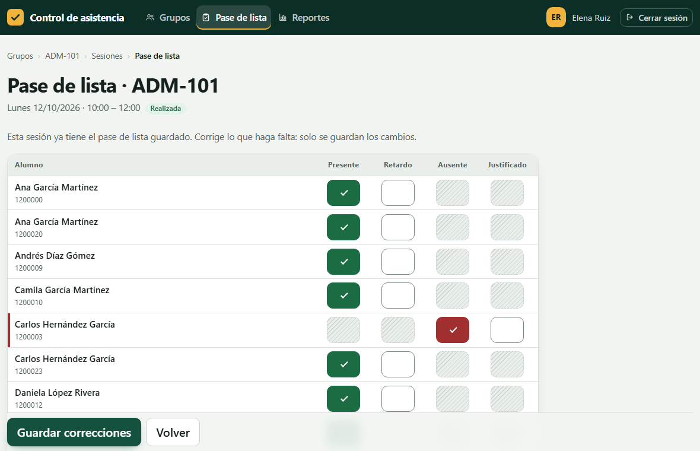

Cambia las casillas del alumno que quieras corregir, con las mismas reglas de la sección 8.2, y pulsa **Guardar correcciones**. Verás «Corrección guardada: N cambios.» o, si no cambiaste nada, «No había cambios que guardar.»

Cada corrección queda en el **Historial de correcciones**, al final de la pantalla, con la **Fecha**, el **Alumno**, el **Cambio** (de qué estado a cuál) y **Quién** lo hizo. Ese historial **no se puede editar ni borrar**.

Si un alumno aparece como «Sin registrar» (porque no se le marcó o se inscribió antes de esa clase pero no se le registró), marca su casilla y guarda para registrarlo.

### 9.2. Adjuntar un justificante

Un justificante solo se puede adjuntar a un registro **Justificado**. En la lista de corrección, bajo ese alumno aparece el enlace **Adjuntar justificante**.

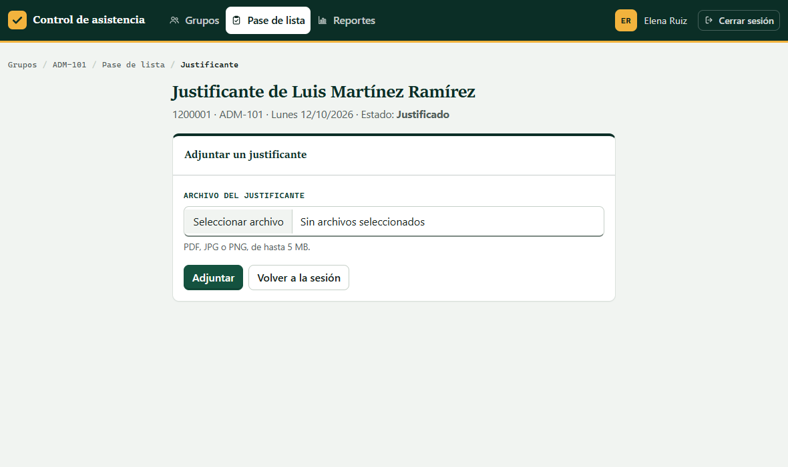

Elige el archivo y pulsa el botón. Debe ser **PDF, JPG o PNG, de hasta 5 MB**; el sistema revisa que el contenido corresponda al tipo del archivo. Hay **un justificante por registro**.

Una vez adjuntado, en esa pantalla puedes:

- **Ver** el archivo;
- **Reemplazar** el justificante con otro archivo (el anterior se borra);
- **Quitar** el justificante, con una confirmación («Sí, quitar el justificante»): el archivo se borra del servidor y el registro sigue como «Justificado».

Los mensajes son «Justificante adjuntado.», «Justificante reemplazado.» y «Justificante quitado.»

Dos reglas que conviene recordar: solo tú, como dueño del grupo, puedes ver el justificante, y un registro que tiene justificante solo puede ser «Justificado». Para cambiarle el estado, primero hay que quitar el justificante (la pantalla te lo avisa).

## 10. Reportes

Pulsa **Reportes** en el menú. Elige el **Periodo** y pulsa **Ver**. Verás, por cada uno de tus grupos, cuántos alumnos tiene, su porcentaje de asistencia y cuántos alumnos están por debajo del mínimo.

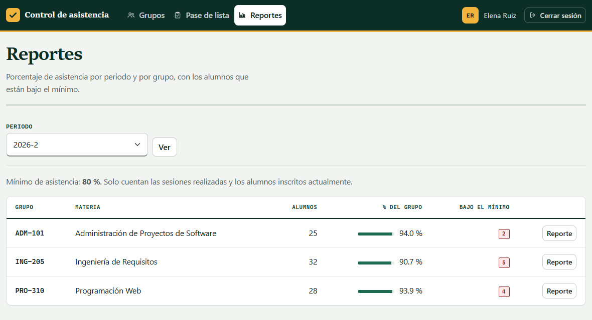

El **mínimo de asistencia** aparece en la pantalla (hoy es 80 %). Solo cuentan las **sesiones realizadas** y los **alumnos inscritos actualmente**.

### 10.1. Reporte de un grupo

Pulsa **Reporte** en un grupo. Arriba ves el porcentaje del grupo, los alumnos, las sesiones realizadas y cuántos alumnos están bajo el mínimo. Debajo, una tabla con cada alumno: sus registros, presentes, retardos, ausentes y justificados, el porcentaje y su **Situación**: «Cumple» o «Bajo el mínimo». Los alumnos bajo el mínimo salen resaltados. Un alumno sin registros muestra «Sin registros» y no se marca como bajo el mínimo.

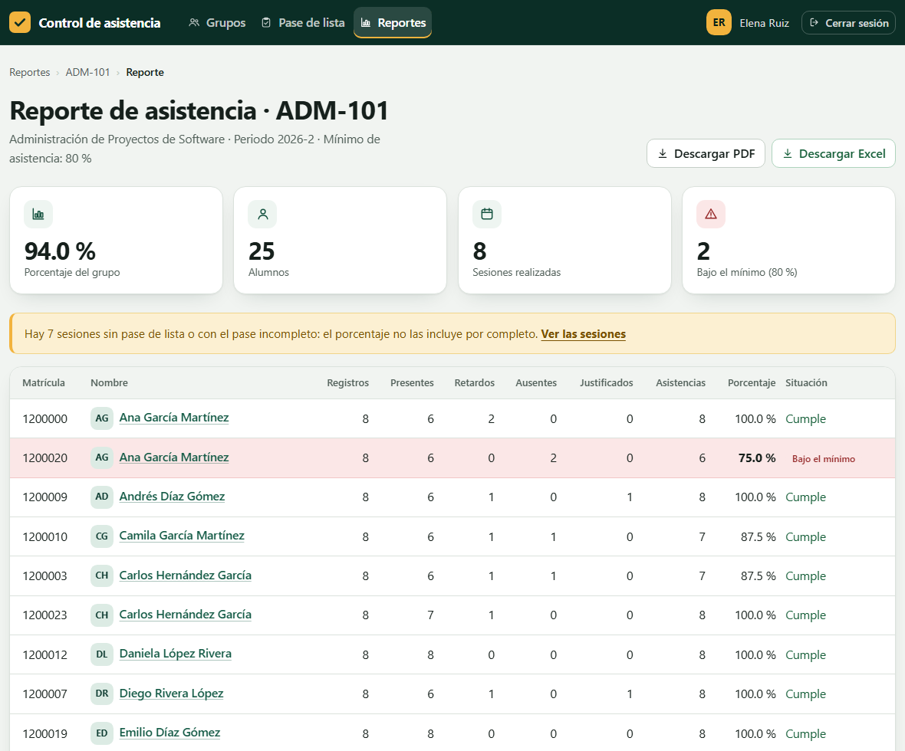

Con **Descargar PDF** y **Descargar Excel** obtienes la misma tabla que ves en pantalla.

### 10.2. Reporte de un alumno

En el reporte del grupo, pulsa el nombre de un alumno. Verás su porcentaje, sus asistencias y el estado que tuvo en cada sesión realizada, y también puedes descargarlo en PDF y Excel.

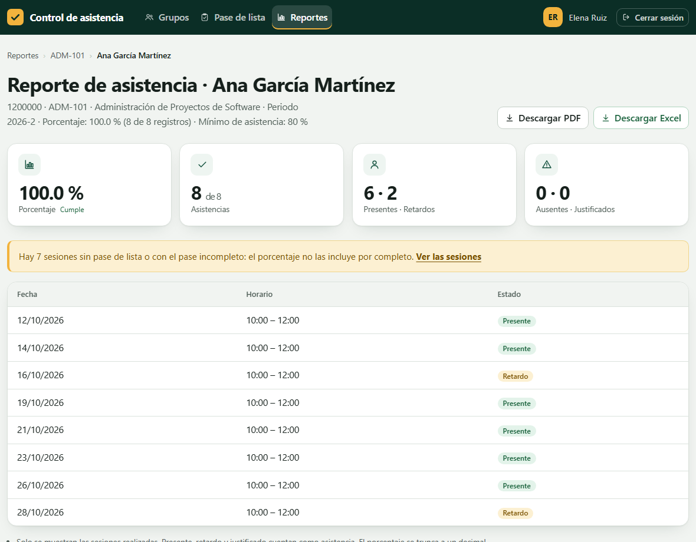

### 10.3. Cómo se calcula el porcentaje

- **Cuentan como asistencia** los estados presente, retardo y justificado.
- **Porcentaje = asistencias ÷ registros × 100.** Se muestra con un decimal **truncado**, no redondeado: 79.9 % se queda en 79.9 %, no pasa a 80.0 %.
- «Bajo el mínimo» significa estrictamente menos que el mínimo.
- Un alumno que se inscribió tarde no se penaliza: no tiene registros de las clases anteriores.
- El porcentaje del grupo es el total de asistencias entre el total de registros de sus alumnos, no el promedio de los porcentajes.

Si el grupo tiene sesiones sin pase de lista o con el pase incompleto, el reporte te lo advierte («el porcentaje no las incluye por completo») y te lleva a las sesiones.

En el PDF, un carácter que el tipo de letra no puede dibujar (por ejemplo, algunos alfabetos distintos del latino) aparece como «?», y el PDF lo avisa. El archivo de Excel conserva el texto completo.

## 11. Grupos de periodos anteriores (solo lectura)

Cuando el administrador desactiva un periodo, sus grupos pasan a **solo lectura**: llevan la etiqueta «Solo lectura» en la lista de grupos y un aviso que dice «Periodo 2026-1 inactivo. Este grupo está en solo lectura: puedes consultarlo y ver sus reportes, pero no modificarlo.»

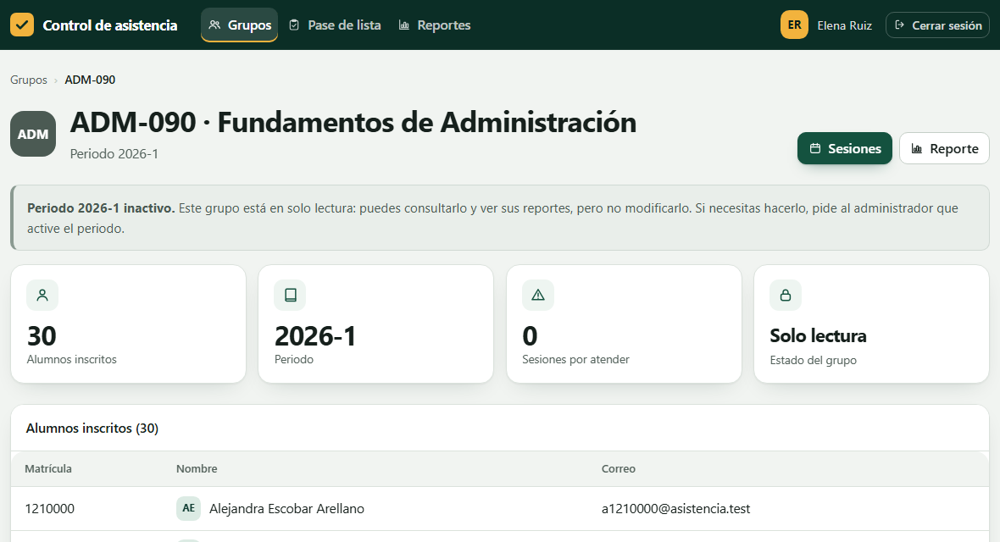

En un grupo de solo lectura **sí puedes** consultar el grupo, sus sesiones y sus listas, ver los reportes, descargar PDF y Excel y ver los justificantes. **No puedes** editar ni eliminar el grupo, cargar o dar de baja alumnos, generar, editar o cancelar sesiones, pasar lista ni corregir, ni adjuntar o quitar justificantes. Si necesitas modificar algo, pide al administrador que active el periodo.

## 12. Si algo no sale como esperabas

| Situación | Qué hacer |
|---|---|
| No puedo crear un grupo | Probablemente no hay un periodo activo. Pide al administrador que active uno. |
| «Tu cuenta está pendiente de aprobación» | Espera a que un administrador apruebe tu cuenta. Avísale que ya te registraste. |
| «Correo o contraseña incorrectos» | Revisa tu correo y tu contraseña. Si no la recuerdas, pide al administrador que te la cambie. |
| «Solo se admiten correos de @uabc.edu.mx» | Regístrate con tu correo institucional. |
| No puedo marcar «Ausente» | Está bloqueada porque «Presente» o «Retardo» están marcados. Quítalos primero (sección 8.2). |
| No puedo marcar «Justificado» | Solo se puede junto con «Ausente». |
| «No se guardó nada» al guardar la lista | Alguna fila tiene casillas incompatibles. Revisa los alumnos que el mensaje menciona. |
| Quiero pasar lista a una clase de la semana que viene | No es posible hasta el día de la clase. |
| El archivo CSV se rechaza | Lee el mensaje: casi siempre es el formato (UTF-8, encabezado `matricula,nombre,correo`) o que tiene más de 500 filas. |
| «No encontramos esa página» | La dirección no existe o ese recurso no es tuyo. Vuelve al inicio y entra de nuevo desde el menú. |
| «No tienes permiso para ver esta página» | Tu rol no incluye esa opción. |
| «Algo salió mal» | El servidor tuvo un problema. Intenta de nuevo en unos minutos y, si continúa, avisa al administrador. |

## 13. Glosario

| Término | Qué significa |
|---|---|
| **Periodo** | Un ciclo escolar (por ejemplo, 2026-2). Solo hay uno activo a la vez; los grupos de los demás quedan en solo lectura. |
| **Grupo** | Una materia que impartes en un periodo, con su clave. |
| **Sesión** | Una clase del grupo en una fecha y hora. Puede estar programada, realizada o cancelada. |
| **Pase de lista** | El registro de asistencia de una sesión. |
| **Estado** | Presente, retardo, ausente o justificado. |
| **Justificante** | Archivo (PDF, JPG o PNG) que respalda una falta justificada. |
| **Padrón** | La lista general de alumnos del sistema, independiente de los grupos. |
| **Bajo el mínimo** | Alumno cuyo porcentaje de asistencia es menor que el mínimo establecido. |
